# HVAC Topology Discovery Benchmark -- Results

## Topology counts (read this first)

- **5 distinct real topologies** are used in the primary `feeds` benchmark below, after merging, exclusions, and duplicate de-duplication (1 duplicate(s) found and excluded from this count).
- **4 additional real topologies** were extracted from the same corpus but are **not** part of the primary `feeds` benchmark (each reason given below); they are still evaluated on `hasPoint`/`hasPart` where those relations are available.
- **10 supplementary synthetic AHU-VAV-zone graphs** are reported **separately** and are never included in the real-topology counts above.

Real topologies and their primary-benchmark status:

| building_id | config_type | feeds available? | reason |
|---|---|---|---|
| sdahu | experimental | True | ok |
| ddahu | experimental | True | ok |
| rtu_exp | experimental | True | ok |
| rtu_sim | simulated | True | ok |
| fcu | experimental | False | zero candidate coverage (entities likely missing rdf:type metadata needed for subclass-based candidate generation) |
| chiller_plant | experimental | False | no asserted edges for this relation |
| boiler_plant | experimental | False | no asserted edges for this relation |
| pfpu | experimental | True | ok |
| sfpu | experimental | False | duplicate of pfpu |

> Note on duplicates: a structural duplicate is flagged when two topologies have the identical multiset of (Brick type, relation-typed edge) after erasing real entity names -- not when they merely share a facility. In this corpus, parallel- and series-fan-powered-unit testbeds (`pfpu`/`sfpu`) are typed generically as `Terminal_Unit` in the source Brick models, so the physical distinction between them (parallel vs. series fan arrangement) is not captured by any type or relation this benchmark can see, making their graphs indistinguishable under this abstraction even though they are different physical equipment.

> **Evidence level: this is a small case-study sample, not a statistically powered benchmark.** 30 seeds per topology/noise condition measure within-topology variability (noise realization + tie-breaking), not additional independent buildings. Results are reported per topology; no pooled cross-topology confidence interval is computed or implied anywhere in this document.

## Data provenance

All Brick models were extracted from the primary Figshare source via ranged HTTP reads (see `provenance.json` for per-file checksums, source URLs, and license/citation metadata).

File-to-building mapping (see `file_to_building.json` for full evidence text):

| building_id | config_type | member files |
|---|---|---|
| sdahu | experimental | 22338283__LBNL_FDD_Data_Sets_SDAHU_ttl.ttl |
| ddahu | experimental | 22338250__LBNL_FDD_Data_Sets_DDAHU_ttl.ttl |
| rtu_exp | experimental | 22338265__LBNL_FDD_Data_Sets_RTU_Exp.ttl |
| rtu_sim | simulated | 22338265__LBNL_FDD_Data_Sets_RTU_Sim.ttl |
| fcu | experimental | 22338256__LBNL_FDD_Data_Sets_FCU_ttl.ttl |
| chiller_plant | experimental | 22338244__LBNL_FDD_Data_Sets_Chiller_Plant.ttl |
| boiler_plant | experimental | 22338238__LBNL_FDD_Data_Sets_Boiler_Plant_ttl.ttl |
| pfpu | experimental | 22344280__LBNL_FDD_Data_Sets_PFPU_ttl.ttl |
| sfpu | experimental | 22344283__LBNL_FDD_Data_Sets_SFPU_ttl.ttl |

## Graph inventory

| building_id | category | nodes | feeds | hasPoint | hasPart | unknown classes | aliases applied |
|---|---|---|---|---|---|---|---|
| sdahu | real | 41 | 5 | 30 | 5 | 1 | 1 |
| ddahu | real | 143 | 10 | 114 | 18 | 1 | 0 |
| rtu_exp | real | 79 | 20 | 74 | 2 | 1 | 0 |
| rtu_sim | real | 29 | 1 | 24 | 3 | 2 | 0 |
| fcu | real | 33 | 1 | 29 | 6 | 0 | 0 |
| chiller_plant | real | 95 | 0 | 79 | 17 | 2 | 1 |
| boiler_plant | real | 27 | 0 | 22 | 4 | 1 | 0 |
| pfpu | real | 137 | 8 | 109 | 19 | 1 | 0 |
| sfpu | real | 137 | 8 | 109 | 19 | 1 | 0 |
| synthetic_00 | synthetic | 44 | 14 | 29 | 7 | 0 | 0 |
| synthetic_01 | synthetic | 48 | 16 | 31 | 8 | 0 | 0 |
| synthetic_02 | synthetic | 22 | 6 | 15 | 3 | 0 | 0 |
| synthetic_03 | synthetic | 31 | 10 | 20 | 5 | 0 | 0 |
| synthetic_04 | synthetic | 34 | 10 | 23 | 5 | 0 | 0 |
| synthetic_05 | synthetic | 38 | 12 | 25 | 6 | 0 | 0 |
| synthetic_06 | synthetic | 34 | 10 | 23 | 5 | 0 | 0 |
| synthetic_07 | synthetic | 45 | 14 | 30 | 7 | 0 | 0 |
| synthetic_08 | synthetic | 36 | 12 | 23 | 6 | 0 | 0 |
| synthetic_09 | synthetic | 55 | 18 | 36 | 9 | 0 | 0 |

## Primary benchmark: `feeds`

For each topology, tests needed to *first* and to *sustainedly* reach the primary P>=90%/R>=90% threshold (secondary P>=95%/R>=95% in parentheses where attained), median [range] across seeds, with attainment rate. Never-attained cells say so plainly.

### sdahu (real) -- independent experiment

**noise = 0%**

| policy | first-attain (90/90) | rate | sustained | rate | final P | final R |
|---|---|---|---|---|---|---|
| active | 0 [0-0] tests (n=30) | 100% | 0 [0-0] tests (n=30) | 100% | 1.00 [1.00-1.00] | 1.00 [1.00-1.00] |
| frozen_initial | 0 [0-0] tests (n=30) | 100% | 0 [0-0] tests (n=30) | 100% | 1.00 [1.00-1.00] | 1.00 [1.00-1.00] |
| rule_based | 0 [0-0] tests (n=30) | 100% | 0 [0-0] tests (n=30) | 100% | 1.00 [1.00-1.00] | 1.00 [1.00-1.00] |
| traversal | 0 [0-0] tests (n=30) | 100% | 0 [0-0] tests (n=30) | 100% | 1.00 [1.00-1.00] | 1.00 [1.00-1.00] |
| random | 0 [0-0] tests (n=30) | 100% | 0 [0-0] tests (n=30) | 100% | 1.00 [1.00-1.00] | 1.00 [1.00-1.00] |

**noise = 5%**

| policy | first-attain (90/90) | rate | sustained | rate | final P | final R |
|---|---|---|---|---|---|---|
| active | 0 [0-0] tests (n=30) | 100% | 0 [0-6] tests (n=30) | 100% | 1.00 [1.00-1.00] | 1.00 [1.00-1.00] |
| frozen_initial | 0 [0-0] tests (n=30) | 100% | 0 [0-6] tests (n=30) | 100% | 1.00 [1.00-1.00] | 1.00 [1.00-1.00] |
| rule_based | 0 [0-0] tests (n=30) | 100% | 0 [0-6] tests (n=30) | 100% | 1.00 [1.00-1.00] | 1.00 [1.00-1.00] |
| traversal | 0 [0-0] tests (n=30) | 100% | 0 [0-6] tests (n=30) | 100% | 1.00 [1.00-1.00] | 1.00 [1.00-1.00] |
| random | 0 [0-0] tests (n=30) | 100% | 0 [0-6] tests (n=30) | 100% | 1.00 [1.00-1.00] | 1.00 [1.00-1.00] |

**noise = 15%**

| policy | first-attain (90/90) | rate | sustained | rate | final P | final R |
|---|---|---|---|---|---|---|
| active | 0 [0-0] tests (n=30) | 100% | 0 [0-18] tests (n=30) | 100% | 1.00 [1.00-1.00] | 1.00 [1.00-1.00] |
| frozen_initial | 0 [0-0] tests (n=30) | 100% | 0 [0-25] tests (n=30) | 100% | 1.00 [1.00-1.00] | 1.00 [1.00-1.00] |
| rule_based | 0 [0-0] tests (n=30) | 100% | 0 [0-25] tests (n=30) | 100% | 1.00 [1.00-1.00] | 1.00 [1.00-1.00] |
| traversal | 0 [0-0] tests (n=30) | 100% | 0 [0-25] tests (n=30) | 100% | 1.00 [1.00-1.00] | 1.00 [1.00-1.00] |
| random | 0 [0-0] tests (n=30) | 100% | 0 [0-25] tests (n=30) | 100% | 1.00 [1.00-1.00] | 1.00 [1.00-1.00] |

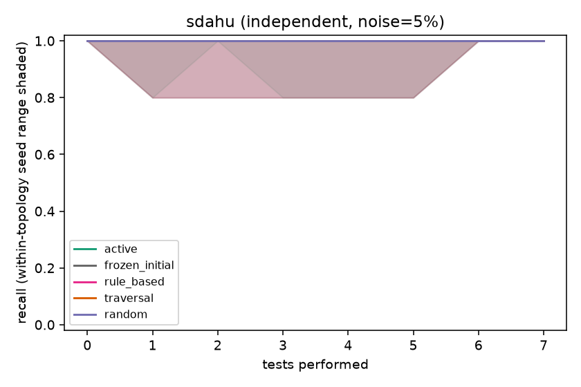

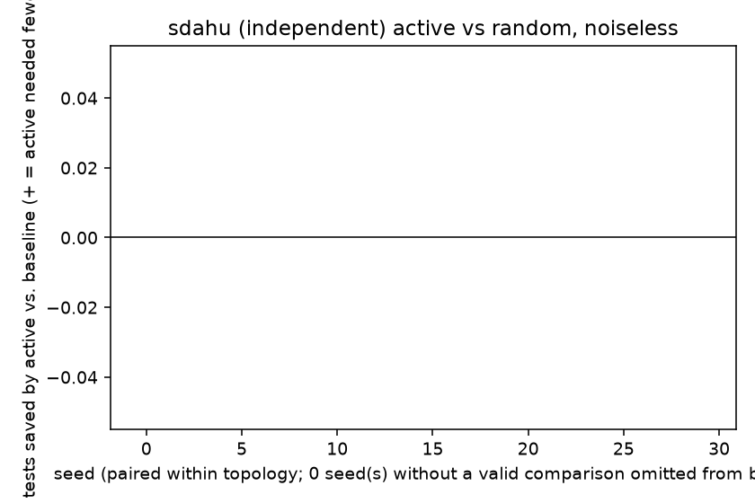

### sdahu (real) -- structured experiment

**noise = 0%**

| policy | first-attain (90/90) | rate | sustained | rate | final P | final R |
|---|---|---|---|---|---|---|
| active | 0 [0-0] tests (n=30) | 100% | 0 [0-0] tests (n=30) | 100% | 1.00 [1.00-1.00] | 1.00 [1.00-1.00] |
| frozen_initial | 0 [0-0] tests (n=30) | 100% | 0 [0-0] tests (n=30) | 100% | 1.00 [1.00-1.00] | 1.00 [1.00-1.00] |
| rule_based | 0 [0-0] tests (n=30) | 100% | 0 [0-0] tests (n=30) | 100% | 1.00 [1.00-1.00] | 1.00 [1.00-1.00] |
| traversal | 0 [0-0] tests (n=30) | 100% | 0 [0-0] tests (n=30) | 100% | 1.00 [1.00-1.00] | 1.00 [1.00-1.00] |
| random | 0 [0-0] tests (n=30) | 100% | 0 [0-0] tests (n=30) | 100% | 1.00 [1.00-1.00] | 1.00 [1.00-1.00] |

**noise = 5%**

| policy | first-attain (90/90) | rate | sustained | rate | final P | final R |
|---|---|---|---|---|---|---|
| active | 0 [0-0] tests (n=30) | 100% | 0 [0-0] tests (n=30) | 100% | 1.00 [1.00-1.00] | 1.00 [1.00-1.00] |
| frozen_initial | 0 [0-0] tests (n=30) | 100% | 0 [0-0] tests (n=30) | 100% | 1.00 [1.00-1.00] | 1.00 [1.00-1.00] |
| rule_based | 0 [0-0] tests (n=30) | 100% | 0 [0-0] tests (n=30) | 100% | 1.00 [1.00-1.00] | 1.00 [1.00-1.00] |
| traversal | 0 [0-0] tests (n=30) | 100% | 0 [0-0] tests (n=30) | 100% | 1.00 [1.00-1.00] | 1.00 [1.00-1.00] |
| random | 0 [0-0] tests (n=30) | 100% | 0 [0-0] tests (n=30) | 100% | 1.00 [1.00-1.00] | 1.00 [1.00-1.00] |

**noise = 15%**

| policy | first-attain (90/90) | rate | sustained | rate | final P | final R |
|---|---|---|---|---|---|---|
| active | 0 [0-0] tests (n=30) | 100% | 0 [0-18] tests (n=30) | 100% | 1.00 [1.00-1.00] | 1.00 [1.00-1.00] |
| frozen_initial | 0 [0-0] tests (n=30) | 100% | 0 [0-18] tests (n=30) | 100% | 1.00 [1.00-1.00] | 1.00 [1.00-1.00] |
| rule_based | 0 [0-0] tests (n=30) | 100% | 0 [0-18] tests (n=30) | 100% | 1.00 [1.00-1.00] | 1.00 [1.00-1.00] |
| traversal | 0 [0-0] tests (n=30) | 100% | 0 [0-18] tests (n=30) | 100% | 1.00 [1.00-1.00] | 1.00 [1.00-1.00] |
| random | 0 [0-0] tests (n=30) | 100% | 0 [0-18] tests (n=30) | 100% | 1.00 [1.00-1.00] | 1.00 [1.00-1.00] |

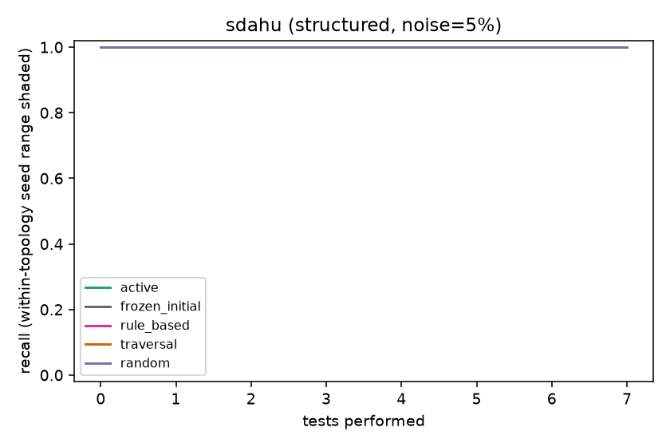

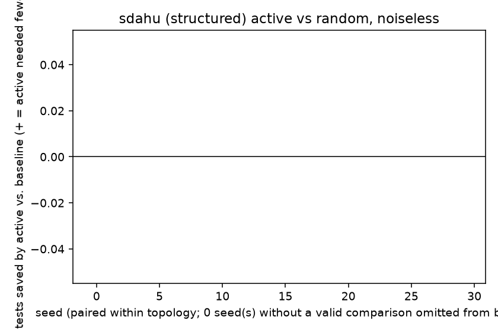

### ddahu (real) -- independent experiment

**noise = 0%**

| policy | first-attain (90/90) | rate | sustained | rate | final P | final R |
|---|---|---|---|---|---|---|
| active | 50 [25-62] tests (n=30) | 100% | 50 [25-62] tests (n=30) | 100% | 1.00 [1.00-1.00] | 1.00 [1.00-1.00] |
| frozen_initial | 50 [25-62] tests (n=30) | 100% | 50 [25-62] tests (n=30) | 100% | 1.00 [1.00-1.00] | 1.00 [1.00-1.00] |
| rule_based | 50 [42-60] tests (n=30) | 100% | 50 [42-60] tests (n=30) | 100% | 1.00 [1.00-1.00] | 1.00 [1.00-1.00] |
| traversal | 52 [29-62] tests (n=30) | 100% | 52 [29-62] tests (n=30) | 100% | 1.00 [1.00-1.00] | 1.00 [1.00-1.00] |
| random | 56 [43-64] tests (n=30) | 100% | 56 [43-64] tests (n=30) | 100% | 1.00 [1.00-1.00] | 1.00 [1.00-1.00] |

**noise = 5%**

| policy | first-attain (90/90) | rate | sustained | rate | final P | final R |
|---|---|---|---|---|---|---|
| active | 68 [39-88] tests (n=28) | 93% | 72 [39-93] tests (n=27) | 90% | 1.00 [0.83-1.00] | 1.00 [0.90-1.00] |
| frozen_initial | 85 [25-99] tests (n=27) | 90% | 87 [58-101] tests (n=27) | 90% | 1.00 [0.83-1.00] | 1.00 [0.90-1.00] |
| rule_based | 83 [53-98] tests (n=27) | 90% | 86 [53-101] tests (n=27) | 90% | 1.00 [0.83-1.00] | 1.00 [0.90-1.00] |
| traversal | 85 [43-99] tests (n=27) | 90% | 88 [59-101] tests (n=27) | 90% | 1.00 [0.83-1.00] | 1.00 [0.90-1.00] |
| random | 81 [55-98] tests (n=27) | 90% | 86 [55-101] tests (n=27) | 90% | 1.00 [0.83-1.00] | 1.00 [0.90-1.00] |

**noise = 15%**

| policy | first-attain (90/90) | rate | sustained | rate | final P | final R |
|---|---|---|---|---|---|---|
| active | 134 [66-204] tests (n=28) | 93% | 139 [90-232] tests (n=28) | 93% | 1.00 [0.77-1.00] | 1.00 [0.80-1.00] |
| frozen_initial | 190 [117-240] tests (n=28) | 93% | 214 [164-246] tests (n=28) | 93% | 1.00 [0.77-1.00] | 1.00 [0.80-1.00] |
| rule_based | 189 [122-240] tests (n=28) | 93% | 214 [164-246] tests (n=28) | 93% | 1.00 [0.77-1.00] | 1.00 [0.80-1.00] |
| traversal | 191 [127-240] tests (n=28) | 93% | 214 [165-246] tests (n=28) | 93% | 1.00 [0.77-1.00] | 1.00 [0.80-1.00] |
| random | 189 [132-240] tests (n=28) | 93% | 214 [174-246] tests (n=28) | 93% | 1.00 [0.77-1.00] | 1.00 [0.80-1.00] |

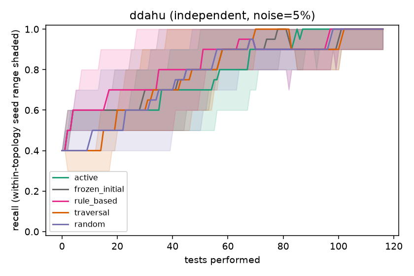
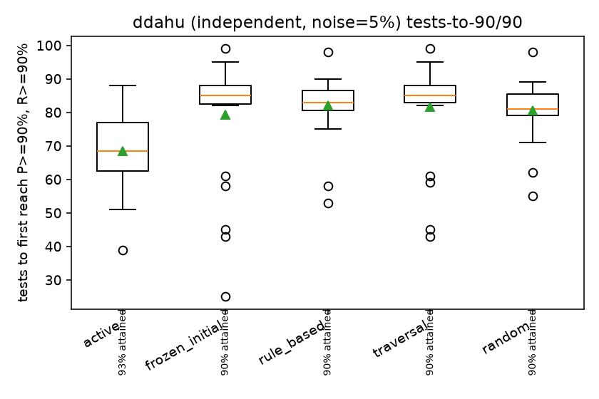

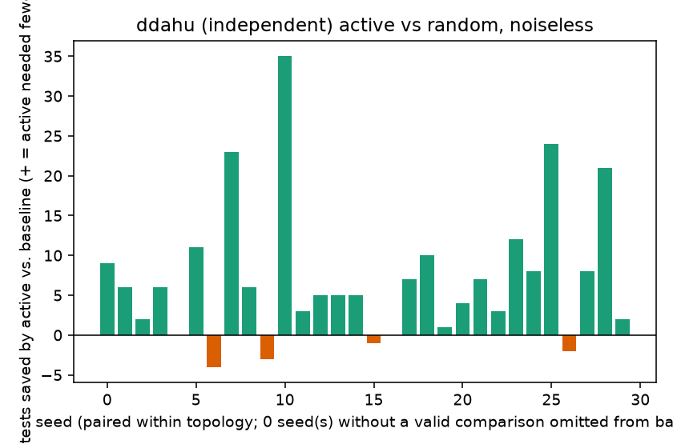

### ddahu (real) -- structured experiment

**noise = 0%**

| policy | first-attain (90/90) | rate | sustained | rate | final P | final R |
|---|---|---|---|---|---|---|
| active | 43 [25-59] tests (n=30) | 100% | 43 [25-59] tests (n=30) | 100% | 1.00 [1.00-1.00] | 1.00 [1.00-1.00] |
| frozen_initial | 66 [64-67] tests (n=30) | 100% | 66 [64-67] tests (n=30) | 100% | 1.00 [1.00-1.00] | 1.00 [1.00-1.00] |
| rule_based | 50 [42-60] tests (n=30) | 100% | 50 [42-60] tests (n=30) | 100% | 1.00 [1.00-1.00] | 1.00 [1.00-1.00] |
| traversal | 52 [29-62] tests (n=30) | 100% | 52 [29-62] tests (n=30) | 100% | 1.00 [1.00-1.00] | 1.00 [1.00-1.00] |
| random | 56 [43-64] tests (n=30) | 100% | 56 [43-64] tests (n=30) | 100% | 1.00 [1.00-1.00] | 1.00 [1.00-1.00] |

**noise = 5%**

| policy | first-attain (90/90) | rate | sustained | rate | final P | final R |
|---|---|---|---|---|---|---|
| active | 68 [48-89] tests (n=28) | 93% | 71 [48-91] tests (n=27) | 90% | 1.00 [0.83-1.00] | 1.00 [0.90-1.00] |
| frozen_initial | 87 [83-102] tests (n=27) | 90% | 89 [83-108] tests (n=27) | 90% | 1.00 [0.83-1.00] | 1.00 [0.90-1.00] |
| rule_based | 85 [81-102] tests (n=27) | 90% | 88 [81-108] tests (n=27) | 90% | 1.00 [0.83-1.00] | 1.00 [0.90-1.00] |
| traversal | 83 [75-101] tests (n=27) | 90% | 88 [75-108] tests (n=27) | 90% | 1.00 [0.83-1.00] | 1.00 [0.90-1.00] |
| random | 85 [80-101] tests (n=27) | 90% | 88 [80-108] tests (n=27) | 90% | 1.00 [0.83-1.00] | 1.00 [0.90-1.00] |

**noise = 15%**

| policy | first-attain (90/90) | rate | sustained | rate | final P | final R |
|---|---|---|---|---|---|---|
| active | 115 [91-146] tests (n=16) | 53% | 115 [91-158] tests (n=16) | 53% | 0.90 [0.71-1.00] | 1.00 [0.80-1.00] |
| frozen_initial | 168 [122-210] tests (n=16) | 53% | 180 [152-220] tests (n=16) | 53% | 0.90 [0.71-1.00] | 1.00 [0.80-1.00] |
| rule_based | 158 [120-206] tests (n=16) | 53% | 178 [152-223] tests (n=16) | 53% | 0.90 [0.71-1.00] | 1.00 [0.80-1.00] |
| traversal | 165 [119-205] tests (n=16) | 53% | 182 [159-225] tests (n=16) | 53% | 0.90 [0.71-1.00] | 1.00 [0.80-1.00] |
| random | 156 [125-197] tests (n=16) | 53% | 180 [151-225] tests (n=16) | 53% | 0.90 [0.71-1.00] | 1.00 [0.80-1.00] |

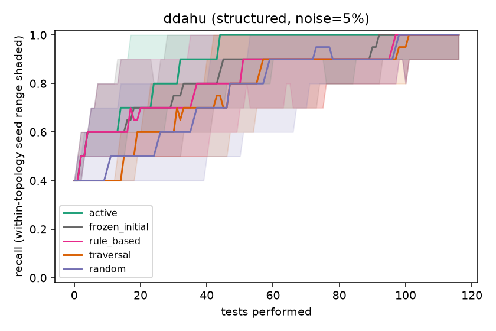
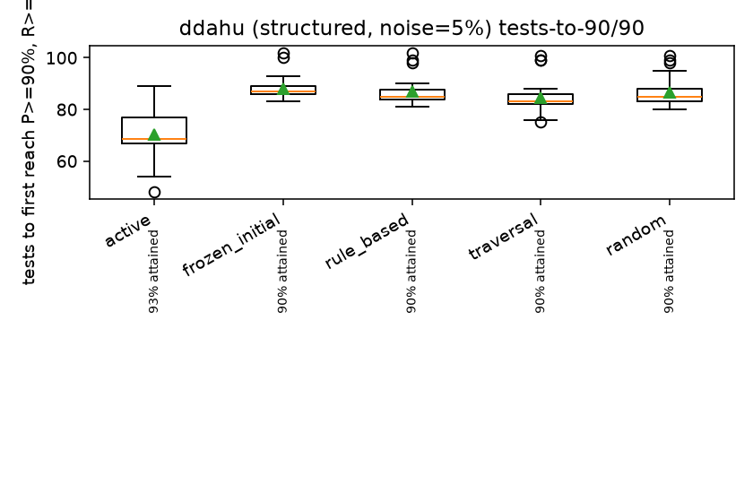

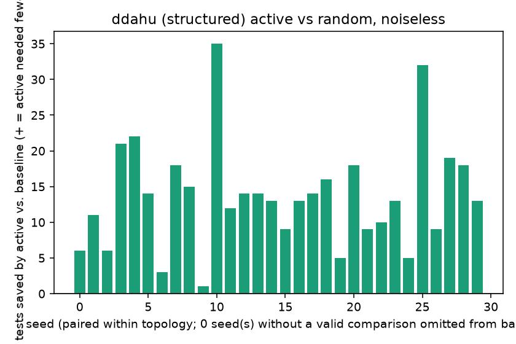

### rtu_exp (real) -- independent experiment

**noise = 0%**

| policy | first-attain (90/90) | rate | sustained | rate | final P | final R |
|---|---|---|---|---|---|---|
| active | 90 [66-117] tests (n=30) | 100% | 90 [66-117] tests (n=30) | 100% | 1.00 [1.00-1.00] | 1.00 [1.00-1.00] |
| frozen_initial | 90 [66-117] tests (n=30) | 100% | 90 [66-117] tests (n=30) | 100% | 1.00 [1.00-1.00] | 1.00 [1.00-1.00] |
| rule_based | 90 [66-117] tests (n=30) | 100% | 90 [66-117] tests (n=30) | 100% | 1.00 [1.00-1.00] | 1.00 [1.00-1.00] |
| traversal | 94 [72-118] tests (n=30) | 100% | 94 [72-118] tests (n=30) | 100% | 1.00 [1.00-1.00] | 1.00 [1.00-1.00] |
| random | 86 [62-117] tests (n=30) | 100% | 86 [62-117] tests (n=30) | 100% | 1.00 [1.00-1.00] | 1.00 [1.00-1.00] |

**noise = 5%**

| policy | first-attain (90/90) | rate | sustained | rate | final P | final R |
|---|---|---|---|---|---|---|
| active | 111 [78-140] tests (n=30) | 100% | 112 [78-140] tests (n=30) | 100% | 1.00 [0.95-1.00] | 1.00 [0.90-1.00] |
| frozen_initial | 127 [85-139] tests (n=30) | 100% | 128 [95-140] tests (n=30) | 100% | 1.00 [0.95-1.00] | 1.00 [0.90-1.00] |
| rule_based | 127 [85-139] tests (n=30) | 100% | 128 [95-140] tests (n=30) | 100% | 1.00 [0.95-1.00] | 1.00 [0.90-1.00] |
| traversal | 126 [89-139] tests (n=30) | 100% | 126 [97-141] tests (n=30) | 100% | 1.00 [0.95-1.00] | 1.00 [0.90-1.00] |
| random | 126 [65-139] tests (n=30) | 100% | 128 [93-139] tests (n=30) | 100% | 1.00 [0.95-1.00] | 1.00 [0.90-1.00] |

**noise = 15%**

| policy | first-attain (90/90) | rate | sustained | rate | final P | final R |
|---|---|---|---|---|---|---|
| active | 160 [111-308] tests (n=30) | 100% | 172 [114-332] tests (n=30) | 100% | 1.00 [0.91-1.00] | 1.00 [0.90-1.00] |
| frozen_initial | 264 [203-355] tests (n=30) | 100% | 318 [215-365] tests (n=30) | 100% | 1.00 [0.91-1.00] | 1.00 [0.90-1.00] |
| rule_based | 264 [203-355] tests (n=30) | 100% | 318 [215-365] tests (n=30) | 100% | 1.00 [0.91-1.00] | 1.00 [0.90-1.00] |
| traversal | 266 [205-355] tests (n=30) | 100% | 318 [217-365] tests (n=30) | 100% | 1.00 [0.91-1.00] | 1.00 [0.90-1.00] |
| random | 262 [197-355] tests (n=30) | 100% | 318 [213-365] tests (n=30) | 100% | 1.00 [0.91-1.00] | 1.00 [0.90-1.00] |

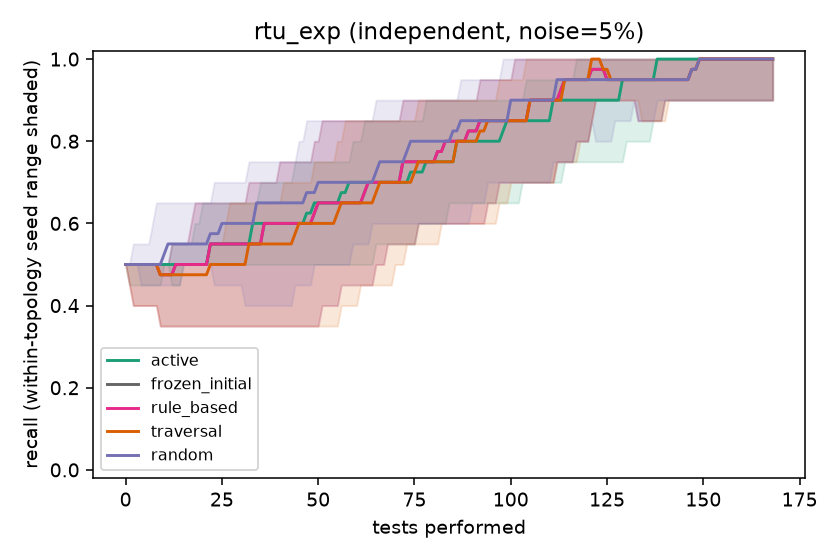
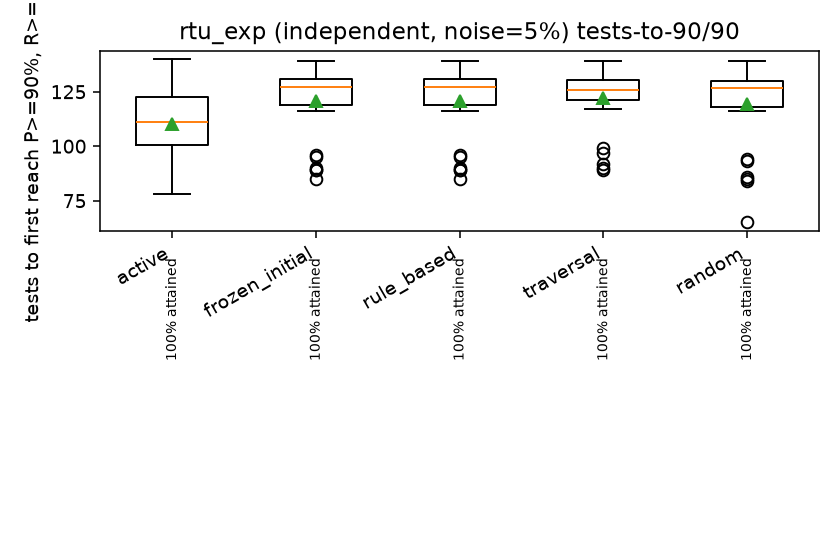

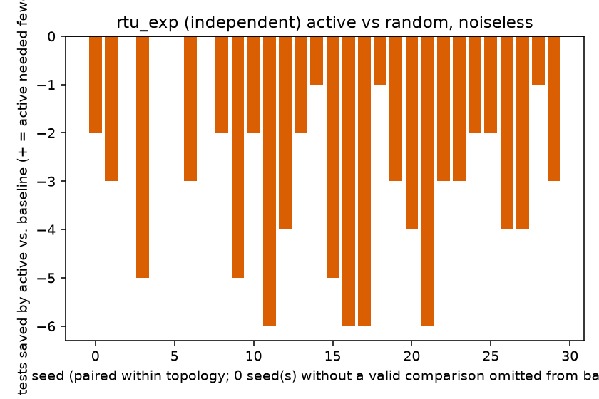

### rtu_exp (real) -- structured experiment

**noise = 0%**

| policy | first-attain (90/90) | rate | sustained | rate | final P | final R |
|---|---|---|---|---|---|---|
| active | 48 [34-64] tests (n=30) | 100% | 48 [34-64] tests (n=30) | 100% | 1.00 [1.00-1.00] | 1.00 [1.00-1.00] |
| frozen_initial | 80 [56-107] tests (n=30) | 100% | 80 [56-107] tests (n=30) | 100% | 1.00 [1.00-1.00] | 1.00 [1.00-1.00] |
| rule_based | 90 [66-117] tests (n=30) | 100% | 90 [66-117] tests (n=30) | 100% | 1.00 [1.00-1.00] | 1.00 [1.00-1.00] |
| traversal | 94 [72-118] tests (n=30) | 100% | 94 [72-118] tests (n=30) | 100% | 1.00 [1.00-1.00] | 1.00 [1.00-1.00] |
| random | 86 [62-117] tests (n=30) | 100% | 86 [62-117] tests (n=30) | 100% | 1.00 [1.00-1.00] | 1.00 [1.00-1.00] |

**noise = 5%**

| policy | first-attain (90/90) | rate | sustained | rate | final P | final R |
|---|---|---|---|---|---|---|
| active | 62 [43-99] tests (n=30) | 100% | 62 [43-99] tests (n=30) | 100% | 1.00 [0.95-1.00] | 1.00 [0.90-1.00] |
| frozen_initial | 122 [57-135] tests (n=30) | 100% | 124 [81-141] tests (n=30) | 100% | 1.00 [0.95-1.00] | 1.00 [0.90-1.00] |
| rule_based | 122 [69-135] tests (n=30) | 100% | 124 [95-140] tests (n=30) | 100% | 1.00 [0.95-1.00] | 1.00 [0.90-1.00] |
| traversal | 122 [76-135] tests (n=30) | 100% | 124 [97-141] tests (n=30) | 100% | 1.00 [0.95-1.00] | 1.00 [0.90-1.00] |
| random | 122 [65-135] tests (n=30) | 100% | 124 [93-138] tests (n=30) | 100% | 1.00 [0.95-1.00] | 1.00 [0.90-1.00] |

**noise = 15%**

| policy | first-attain (90/90) | rate | sustained | rate | final P | final R |
|---|---|---|---|---|---|---|
| active | 106 [56-228] tests (n=30) | 100% | 113 [56-230] tests (n=30) | 100% | 1.00 [0.90-1.00] | 1.00 [0.90-1.00] |
| frozen_initial | 231 [153-298] tests (n=30) | 100% | 262 [153-328] tests (n=30) | 100% | 1.00 [0.95-1.00] | 1.00 [0.90-1.00] |
| rule_based | 234 [159-299] tests (n=30) | 100% | 264 [185-328] tests (n=30) | 100% | 1.00 [0.95-1.00] | 1.00 [0.90-1.00] |
| traversal | 236 [165-300] tests (n=30) | 100% | 263 [190-329] tests (n=30) | 100% | 1.00 [0.95-1.00] | 1.00 [0.90-1.00] |
| random | 233 [159-285] tests (n=30) | 100% | 264 [184-328] tests (n=30) | 100% | 1.00 [0.95-1.00] | 1.00 [0.90-1.00] |

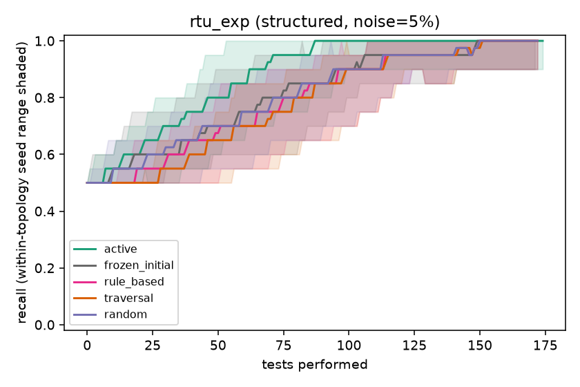
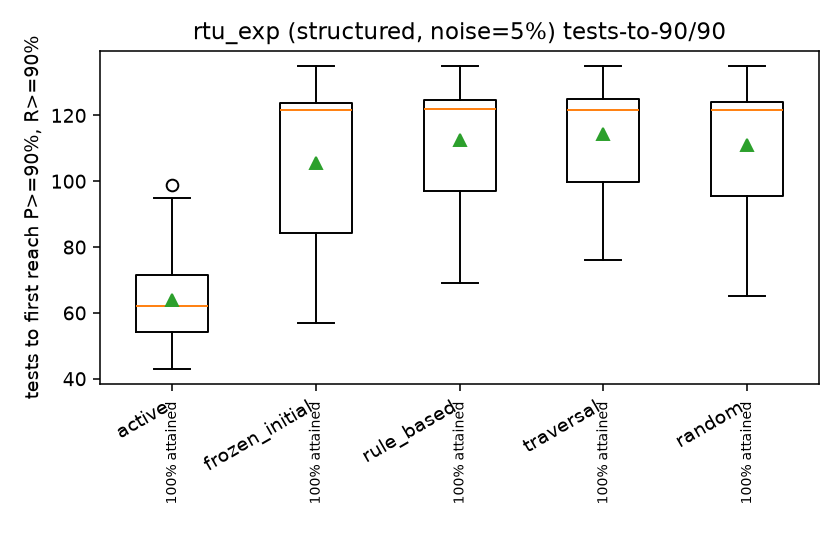

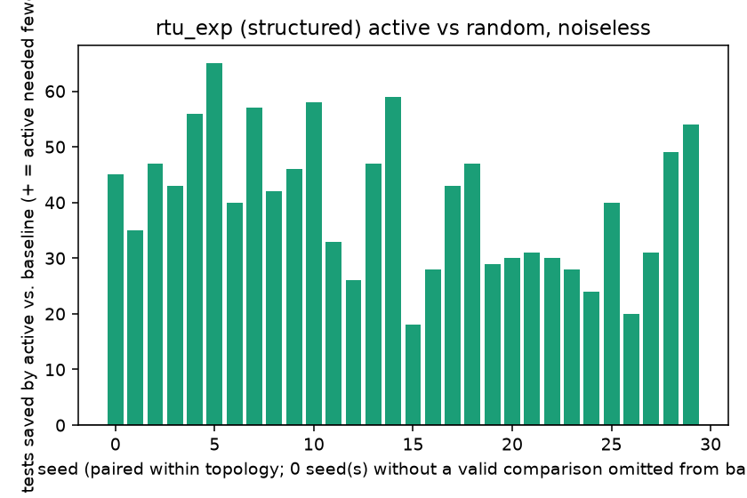

### rtu_sim (real) -- independent experiment

**noise = 0%**

| policy | first-attain (90/90) | rate | sustained | rate | final P | final R |
|---|---|---|---|---|---|---|
| active | 0 [0-0] tests (n=30) | 100% | 0 [0-0] tests (n=30) | 100% | 1.00 [1.00-1.00] | 1.00 [1.00-1.00] |
| frozen_initial | 0 [0-0] tests (n=30) | 100% | 0 [0-0] tests (n=30) | 100% | 1.00 [1.00-1.00] | 1.00 [1.00-1.00] |
| rule_based | 0 [0-0] tests (n=30) | 100% | 0 [0-0] tests (n=30) | 100% | 1.00 [1.00-1.00] | 1.00 [1.00-1.00] |
| traversal | 0 [0-0] tests (n=30) | 100% | 0 [0-0] tests (n=30) | 100% | 1.00 [1.00-1.00] | 1.00 [1.00-1.00] |
| random | 0 [0-0] tests (n=30) | 100% | 0 [0-0] tests (n=30) | 100% | 1.00 [1.00-1.00] | 1.00 [1.00-1.00] |

**noise = 5%**

| policy | first-attain (90/90) | rate | sustained | rate | final P | final R |
|---|---|---|---|---|---|---|
| active | 0 [0-0] tests (n=30) | 100% | 0 [0-2] tests (n=30) | 100% | 1.00 [1.00-1.00] | 1.00 [1.00-1.00] |
| frozen_initial | 0 [0-0] tests (n=30) | 100% | 0 [0-2] tests (n=30) | 100% | 1.00 [1.00-1.00] | 1.00 [1.00-1.00] |
| rule_based | 0 [0-0] tests (n=30) | 100% | 0 [0-2] tests (n=30) | 100% | 1.00 [1.00-1.00] | 1.00 [1.00-1.00] |
| traversal | 0 [0-0] tests (n=30) | 100% | 0 [0-2] tests (n=30) | 100% | 1.00 [1.00-1.00] | 1.00 [1.00-1.00] |
| random | 0 [0-0] tests (n=30) | 100% | 0 [0-2] tests (n=30) | 100% | 1.00 [1.00-1.00] | 1.00 [1.00-1.00] |

**noise = 15%**

| policy | first-attain (90/90) | rate | sustained | rate | final P | final R |
|---|---|---|---|---|---|---|
| active | 0 [0-0] tests (n=30) | 100% | 0 [0-0] tests (n=30) | 100% | 1.00 [1.00-1.00] | 1.00 [1.00-1.00] |
| frozen_initial | 0 [0-0] tests (n=30) | 100% | 0 [0-0] tests (n=30) | 100% | 1.00 [1.00-1.00] | 1.00 [1.00-1.00] |
| rule_based | 0 [0-0] tests (n=30) | 100% | 0 [0-0] tests (n=30) | 100% | 1.00 [1.00-1.00] | 1.00 [1.00-1.00] |
| traversal | 0 [0-0] tests (n=30) | 100% | 0 [0-0] tests (n=30) | 100% | 1.00 [1.00-1.00] | 1.00 [1.00-1.00] |
| random | 0 [0-0] tests (n=30) | 100% | 0 [0-0] tests (n=30) | 100% | 1.00 [1.00-1.00] | 1.00 [1.00-1.00] |

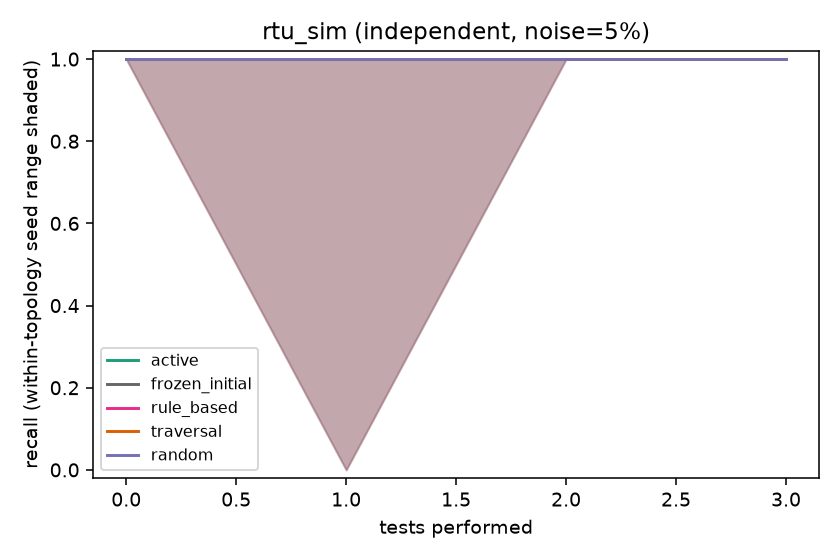

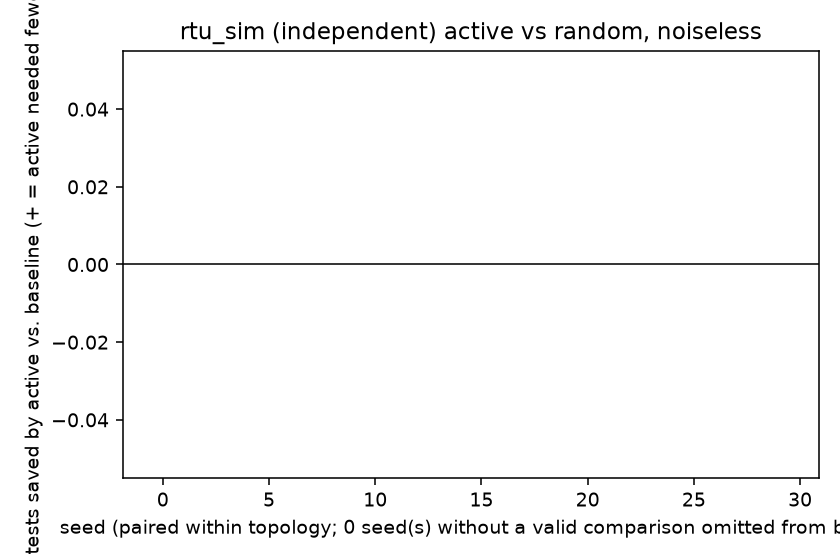

### rtu_sim (real) -- structured experiment

**noise = 0%**

| policy | first-attain (90/90) | rate | sustained | rate | final P | final R |
|---|---|---|---|---|---|---|
| active | 0 [0-0] tests (n=30) | 100% | 0 [0-0] tests (n=30) | 100% | 1.00 [1.00-1.00] | 1.00 [1.00-1.00] |
| frozen_initial | 0 [0-0] tests (n=30) | 100% | 0 [0-0] tests (n=30) | 100% | 1.00 [1.00-1.00] | 1.00 [1.00-1.00] |
| rule_based | 0 [0-0] tests (n=30) | 100% | 0 [0-0] tests (n=30) | 100% | 1.00 [1.00-1.00] | 1.00 [1.00-1.00] |
| traversal | 0 [0-0] tests (n=30) | 100% | 0 [0-0] tests (n=30) | 100% | 1.00 [1.00-1.00] | 1.00 [1.00-1.00] |
| random | 0 [0-0] tests (n=30) | 100% | 0 [0-0] tests (n=30) | 100% | 1.00 [1.00-1.00] | 1.00 [1.00-1.00] |

**noise = 5%**

| policy | first-attain (90/90) | rate | sustained | rate | final P | final R |
|---|---|---|---|---|---|---|
| active | 0 [0-0] tests (n=30) | 100% | 0 [0-0] tests (n=30) | 100% | 1.00 [1.00-1.00] | 1.00 [1.00-1.00] |
| frozen_initial | 0 [0-0] tests (n=30) | 100% | 0 [0-0] tests (n=30) | 100% | 1.00 [1.00-1.00] | 1.00 [1.00-1.00] |
| rule_based | 0 [0-0] tests (n=30) | 100% | 0 [0-0] tests (n=30) | 100% | 1.00 [1.00-1.00] | 1.00 [1.00-1.00] |
| traversal | 0 [0-0] tests (n=30) | 100% | 0 [0-0] tests (n=30) | 100% | 1.00 [1.00-1.00] | 1.00 [1.00-1.00] |
| random | 0 [0-0] tests (n=30) | 100% | 0 [0-0] tests (n=30) | 100% | 1.00 [1.00-1.00] | 1.00 [1.00-1.00] |

**noise = 15%**

| policy | first-attain (90/90) | rate | sustained | rate | final P | final R |
|---|---|---|---|---|---|---|
| active | 0 [0-0] tests (n=30) | 100% | 0 [0-0] tests (n=30) | 100% | 1.00 [1.00-1.00] | 1.00 [1.00-1.00] |
| frozen_initial | 0 [0-0] tests (n=30) | 100% | 0 [0-0] tests (n=30) | 100% | 1.00 [1.00-1.00] | 1.00 [1.00-1.00] |
| rule_based | 0 [0-0] tests (n=30) | 100% | 0 [0-0] tests (n=30) | 100% | 1.00 [1.00-1.00] | 1.00 [1.00-1.00] |
| traversal | 0 [0-0] tests (n=30) | 100% | 0 [0-0] tests (n=30) | 100% | 1.00 [1.00-1.00] | 1.00 [1.00-1.00] |
| random | 0 [0-0] tests (n=30) | 100% | 0 [0-0] tests (n=30) | 100% | 1.00 [1.00-1.00] | 1.00 [1.00-1.00] |

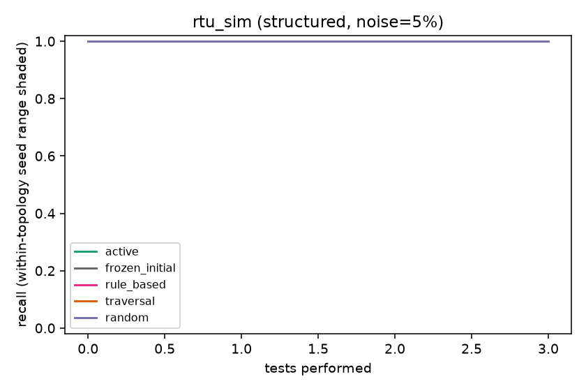
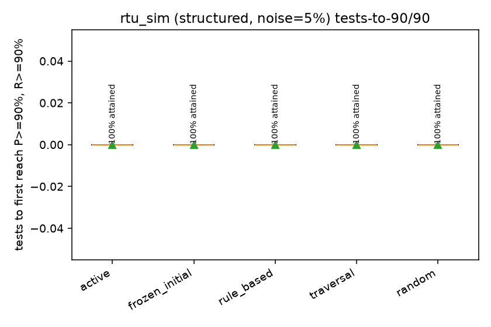

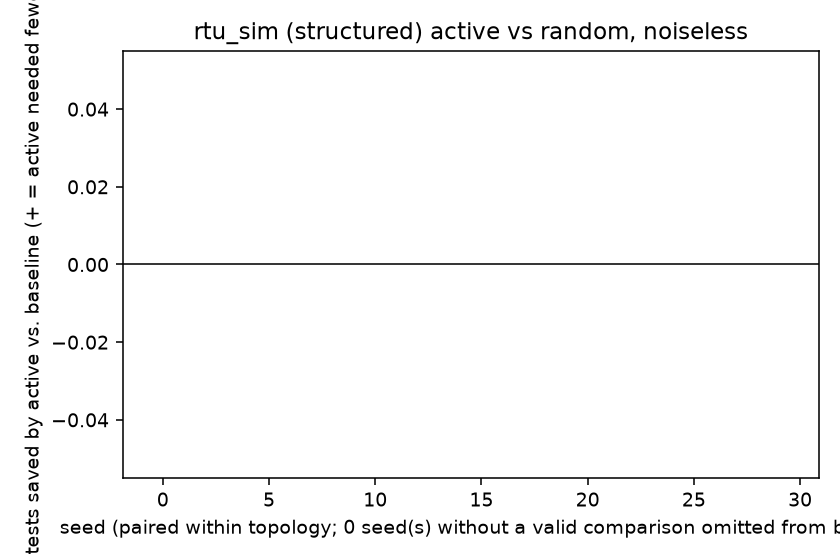

### pfpu (real) -- independent experiment

**noise = 0%**

| policy | first-attain (90/90) | rate | sustained | rate | final P | final R |
|---|---|---|---|---|---|---|
| active | 17 [11-20] tests (n=30) | 100% | 17 [11-20] tests (n=30) | 100% | 1.00 [1.00-1.00] | 1.00 [1.00-1.00] |
| frozen_initial | 17 [11-20] tests (n=30) | 100% | 17 [11-20] tests (n=30) | 100% | 1.00 [1.00-1.00] | 1.00 [1.00-1.00] |
| rule_based | 20 [13-24] tests (n=30) | 100% | 20 [13-24] tests (n=30) | 100% | 1.00 [1.00-1.00] | 1.00 [1.00-1.00] |
| traversal | 21 [17-24] tests (n=30) | 100% | 21 [17-24] tests (n=30) | 100% | 1.00 [1.00-1.00] | 1.00 [1.00-1.00] |
| random | 20 [13-24] tests (n=30) | 100% | 20 [13-24] tests (n=30) | 100% | 1.00 [1.00-1.00] | 1.00 [1.00-1.00] |

**noise = 5%**

| policy | first-attain (90/90) | rate | sustained | rate | final P | final R |
|---|---|---|---|---|---|---|
| active | 22 [13-49] tests (n=30) | 100% | 25 [14-50] tests (n=30) | 100% | 1.00 [1.00-1.00] | 1.00 [1.00-1.00] |
| frozen_initial | 27 [13-53] tests (n=30) | 100% | 44 [14-58] tests (n=30) | 100% | 1.00 [1.00-1.00] | 1.00 [1.00-1.00] |
| rule_based | 34 [13-53] tests (n=30) | 100% | 42 [17-58] tests (n=30) | 100% | 1.00 [1.00-1.00] | 1.00 [1.00-1.00] |
| traversal | 29 [19-52] tests (n=30) | 100% | 39 [19-58] tests (n=30) | 100% | 1.00 [1.00-1.00] | 1.00 [1.00-1.00] |
| random | 34 [13-53] tests (n=30) | 100% | 42 [17-58] tests (n=30) | 100% | 1.00 [1.00-1.00] | 1.00 [1.00-1.00] |

**noise = 15%**

| policy | first-attain (90/90) | rate | sustained | rate | final P | final R |
|---|---|---|---|---|---|---|
| active | 37 [20-76] tests (n=26) | 87% | 52 [20-89] tests (n=25) | 83% | 1.00 [0.89-1.00] | 1.00 [0.88-1.00] |
| frozen_initial | 58 [15-81] tests (n=27) | 90% | 67 [19-86] tests (n=25) | 83% | 1.00 [0.89-1.00] | 1.00 [0.88-1.00] |
| rule_based | 57 [17-81] tests (n=27) | 90% | 67 [23-86] tests (n=25) | 83% | 1.00 [0.89-1.00] | 1.00 [0.88-1.00] |
| traversal | 57 [19-81] tests (n=27) | 90% | 67 [23-86] tests (n=25) | 83% | 1.00 [0.89-1.00] | 1.00 [0.88-1.00] |
| random | 57 [17-81] tests (n=27) | 90% | 67 [23-86] tests (n=25) | 83% | 1.00 [0.89-1.00] | 1.00 [0.88-1.00] |

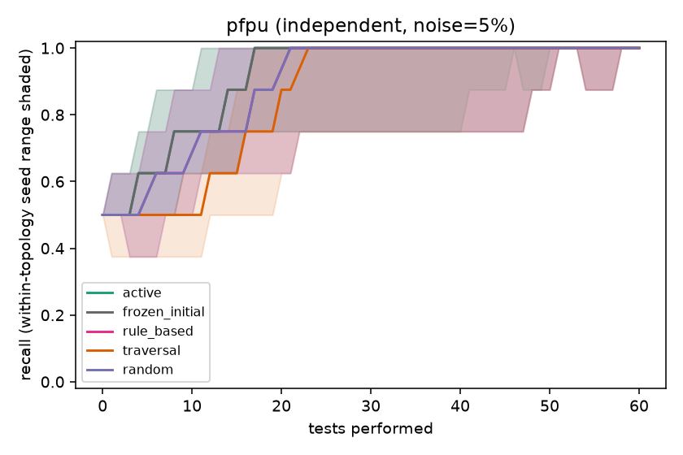
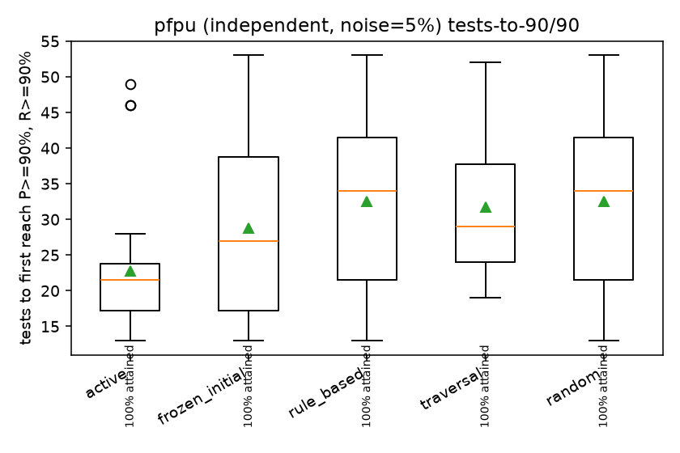

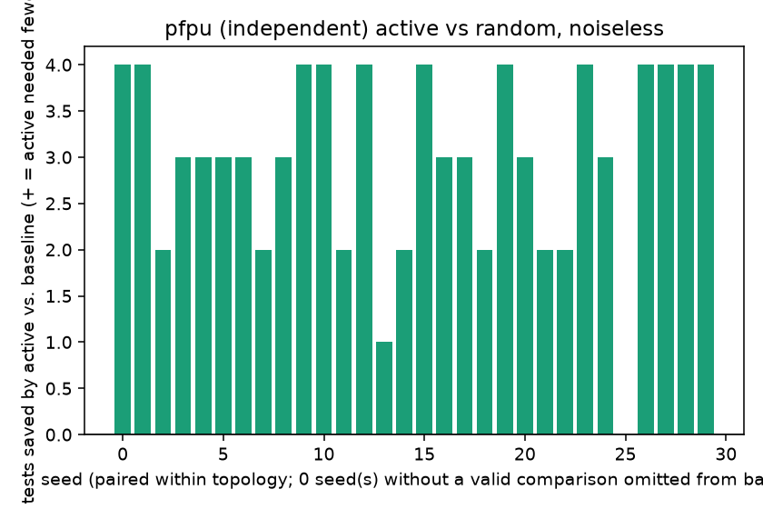

### pfpu (real) -- structured experiment

**noise = 0%**

| policy | first-attain (90/90) | rate | sustained | rate | final P | final R |
|---|---|---|---|---|---|---|
| active | 12 [6-16] tests (n=30) | 100% | 12 [6-16] tests (n=30) | 100% | 1.00 [1.00-1.00] | 1.00 [1.00-1.00] |
| frozen_initial | 17 [11-20] tests (n=30) | 100% | 17 [11-20] tests (n=30) | 100% | 1.00 [1.00-1.00] | 1.00 [1.00-1.00] |
| rule_based | 20 [13-24] tests (n=30) | 100% | 20 [13-24] tests (n=30) | 100% | 1.00 [1.00-1.00] | 1.00 [1.00-1.00] |
| traversal | 21 [17-24] tests (n=30) | 100% | 21 [17-24] tests (n=30) | 100% | 1.00 [1.00-1.00] | 1.00 [1.00-1.00] |
| random | 20 [13-24] tests (n=30) | 100% | 20 [13-24] tests (n=30) | 100% | 1.00 [1.00-1.00] | 1.00 [1.00-1.00] |

**noise = 5%**

| policy | first-attain (90/90) | rate | sustained | rate | final P | final R |
|---|---|---|---|---|---|---|
| active | 14 [9-46] tests (n=30) | 100% | 19 [9-46] tests (n=30) | 100% | 1.00 [1.00-1.00] | 1.00 [1.00-1.00] |
| frozen_initial | 29 [7-45] tests (n=29) | 97% | 36 [14-45] tests (n=29) | 97% | 1.00 [1.00-1.00] | 1.00 [0.88-1.00] |
| rule_based | 27 [13-46] tests (n=30) | 100% | 34 [13-46] tests (n=30) | 100% | 1.00 [1.00-1.00] | 1.00 [1.00-1.00] |
| traversal | 28 [19-47] tests (n=30) | 100% | 37 [19-49] tests (n=30) | 100% | 1.00 [1.00-1.00] | 1.00 [1.00-1.00] |
| random | 27 [13-46] tests (n=30) | 100% | 34 [13-46] tests (n=30) | 100% | 1.00 [1.00-1.00] | 1.00 [1.00-1.00] |

**noise = 15%**

| policy | first-attain (90/90) | rate | sustained | rate | final P | final R |
|---|---|---|---|---|---|---|
| active | 26 [14-58] tests (n=29) | 97% | 29 [15-60] tests (n=27) | 90% | 1.00 [0.89-1.00] | 1.00 [0.88-1.00] |
| frozen_initial | 51 [13-77] tests (n=29) | 97% | 63 [13-87] tests (n=27) | 90% | 1.00 [0.89-1.00] | 1.00 [0.88-1.00] |
| rule_based | 54 [17-77] tests (n=29) | 97% | 60 [23-86] tests (n=27) | 90% | 1.00 [0.89-1.00] | 1.00 [0.88-1.00] |
| traversal | 54 [19-76] tests (n=29) | 97% | 60 [23-86] tests (n=27) | 90% | 1.00 [0.89-1.00] | 1.00 [0.88-1.00] |
| random | 54 [17-77] tests (n=29) | 97% | 60 [23-86] tests (n=27) | 90% | 1.00 [0.89-1.00] | 1.00 [0.88-1.00] |

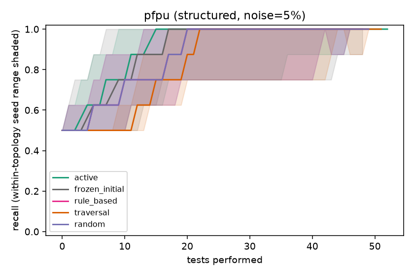
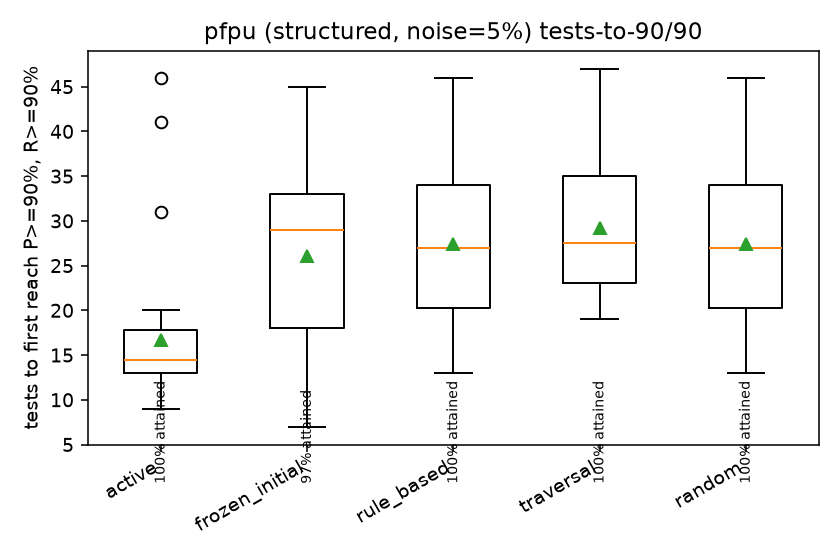

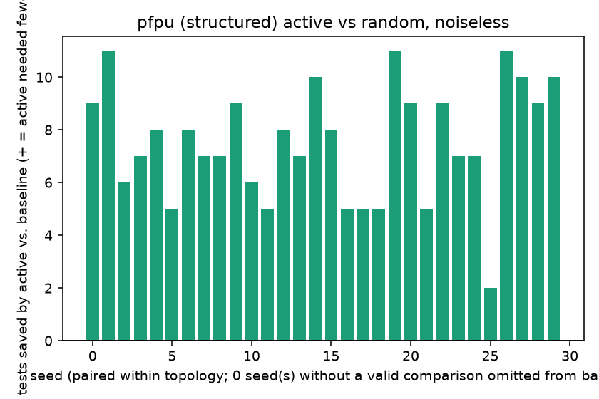

### synthetic_00 (synthetic) -- independent experiment

**noise = 0%**

| policy | first-attain (90/90) | rate | sustained | rate | final P | final R |
|---|---|---|---|---|---|---|
| active | 46 [25-54] tests (n=30) | 100% | 46 [25-54] tests (n=30) | 100% | 1.00 [1.00-1.00] | 1.00 [1.00-1.00] |
| frozen_initial | 46 [25-54] tests (n=30) | 100% | 46 [25-54] tests (n=30) | 100% | 1.00 [1.00-1.00] | 1.00 [1.00-1.00] |
| rule_based | 45 [25-53] tests (n=30) | 100% | 45 [25-53] tests (n=30) | 100% | 1.00 [1.00-1.00] | 1.00 [1.00-1.00] |
| traversal | 54 [38-61] tests (n=30) | 100% | 54 [38-61] tests (n=30) | 100% | 1.00 [1.00-1.00] | 1.00 [1.00-1.00] |
| random | 50 [26-60] tests (n=30) | 100% | 50 [26-60] tests (n=30) | 100% | 1.00 [1.00-1.00] | 1.00 [1.00-1.00] |

**noise = 5%**

| policy | first-attain (90/90) | rate | sustained | rate | final P | final R |
|---|---|---|---|---|---|---|
| active | 58 [33-68] tests (n=29) | 97% | 59 [33-79] tests (n=29) | 97% | 1.00 [1.00-1.00] | 1.00 [0.86-1.00] |
| frozen_initial | 67 [26-76] tests (n=29) | 97% | 69 [31-76] tests (n=29) | 97% | 1.00 [1.00-1.00] | 1.00 [0.86-1.00] |
| rule_based | 66 [29-75] tests (n=29) | 97% | 69 [34-76] tests (n=29) | 97% | 1.00 [1.00-1.00] | 1.00 [0.86-1.00] |
| traversal | 67 [38-76] tests (n=29) | 97% | 68 [50-76] tests (n=29) | 97% | 1.00 [1.00-1.00] | 1.00 [0.86-1.00] |
| random | 67 [31-76] tests (n=29) | 97% | 69 [37-76] tests (n=29) | 97% | 1.00 [1.00-1.00] | 1.00 [0.86-1.00] |

**noise = 15%**

| policy | first-attain (90/90) | rate | sustained | rate | final P | final R |
|---|---|---|---|---|---|---|
| active | 85 [41-193] tests (n=30) | 100% | 87 [58-193] tests (n=30) | 100% | 1.00 [0.93-1.00] | 1.00 [0.93-1.00] |
| frozen_initial | 152 [89-194] tests (n=30) | 100% | 180 [119-197] tests (n=30) | 100% | 1.00 [0.93-1.00] | 1.00 [0.93-1.00] |
| rule_based | 144 [92-194] tests (n=30) | 100% | 179 [119-197] tests (n=30) | 100% | 1.00 [0.93-1.00] | 1.00 [0.93-1.00] |
| traversal | 144 [101-194] tests (n=30) | 100% | 182 [126-199] tests (n=30) | 100% | 1.00 [0.93-1.00] | 1.00 [0.93-1.00] |
| random | 152 [94-194] tests (n=30) | 100% | 181 [126-197] tests (n=30) | 100% | 1.00 [0.93-1.00] | 1.00 [0.93-1.00] |

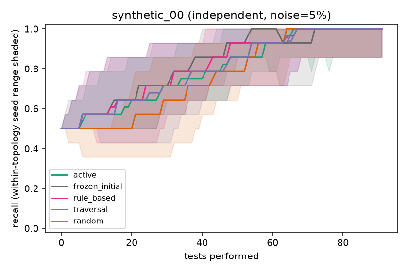
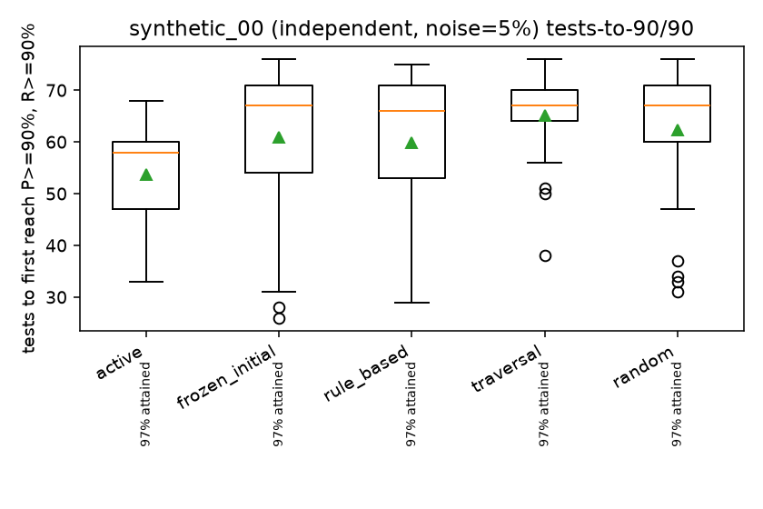

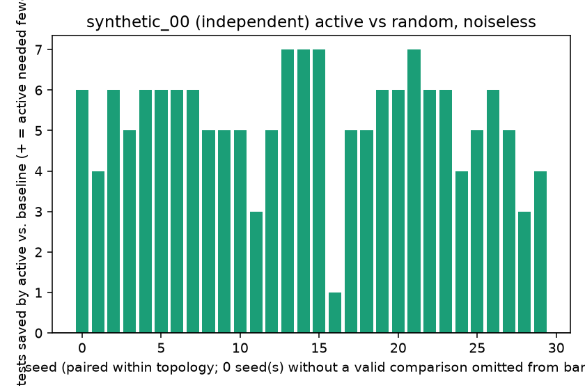

### synthetic_00 (synthetic) -- structured experiment

**noise = 0%**

| policy | first-attain (90/90) | rate | sustained | rate | final P | final R |
|---|---|---|---|---|---|---|
| active | 27 [14-39] tests (n=30) | 100% | 27 [14-39] tests (n=30) | 100% | 1.00 [1.00-1.00] | 1.00 [1.00-1.00] |
| frozen_initial | 46 [25-54] tests (n=30) | 100% | 46 [25-54] tests (n=30) | 100% | 1.00 [1.00-1.00] | 1.00 [1.00-1.00] |
| rule_based | 45 [25-53] tests (n=30) | 100% | 45 [25-53] tests (n=30) | 100% | 1.00 [1.00-1.00] | 1.00 [1.00-1.00] |
| traversal | 54 [38-61] tests (n=30) | 100% | 54 [38-61] tests (n=30) | 100% | 1.00 [1.00-1.00] | 1.00 [1.00-1.00] |
| random | 50 [26-60] tests (n=30) | 100% | 50 [26-60] tests (n=30) | 100% | 1.00 [1.00-1.00] | 1.00 [1.00-1.00] |

**noise = 5%**

| policy | first-attain (90/90) | rate | sustained | rate | final P | final R |
|---|---|---|---|---|---|---|
| active | 38 [20-86] tests (n=30) | 100% | 38 [20-86] tests (n=30) | 100% | 1.00 [1.00-1.00] | 1.00 [0.93-1.00] |
| frozen_initial | 67 [25-89] tests (n=30) | 100% | 68 [25-89] tests (n=30) | 100% | 1.00 [1.00-1.00] | 1.00 [0.93-1.00] |
| rule_based | 65 [29-84] tests (n=30) | 100% | 68 [33-84] tests (n=30) | 100% | 1.00 [1.00-1.00] | 1.00 [0.93-1.00] |
| traversal | 65 [38-85] tests (n=30) | 100% | 69 [44-85] tests (n=30) | 100% | 1.00 [1.00-1.00] | 1.00 [0.93-1.00] |
| random | 66 [31-85] tests (n=30) | 100% | 68 [34-85] tests (n=30) | 100% | 1.00 [1.00-1.00] | 1.00 [0.93-1.00] |

**noise = 15%**

| policy | first-attain (90/90) | rate | sustained | rate | final P | final R |
|---|---|---|---|---|---|---|
| active | 54 [27-99] tests (n=30) | 100% | 54 [27-120] tests (n=30) | 100% | 1.00 [0.93-1.00] | 1.00 [0.93-1.00] |
| frozen_initial | 124 [67-172] tests (n=30) | 100% | 148 [82-180] tests (n=30) | 100% | 1.00 [0.93-1.00] | 1.00 [0.93-1.00] |
| rule_based | 124 [68-172] tests (n=30) | 100% | 151 [84-183] tests (n=30) | 100% | 1.00 [0.93-1.00] | 1.00 [0.93-1.00] |
| traversal | 126 [76-172] tests (n=30) | 100% | 152 [91-187] tests (n=30) | 100% | 1.00 [0.93-1.00] | 1.00 [0.93-1.00] |
| random | 125 [69-172] tests (n=30) | 100% | 151 [85-187] tests (n=30) | 100% | 1.00 [0.93-1.00] | 1.00 [0.93-1.00] |

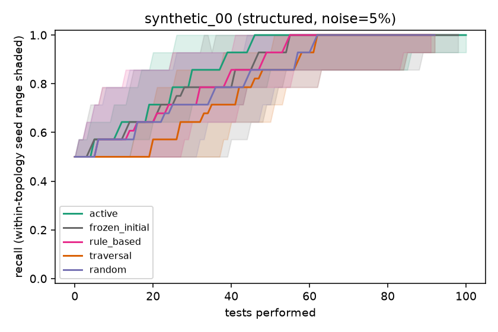
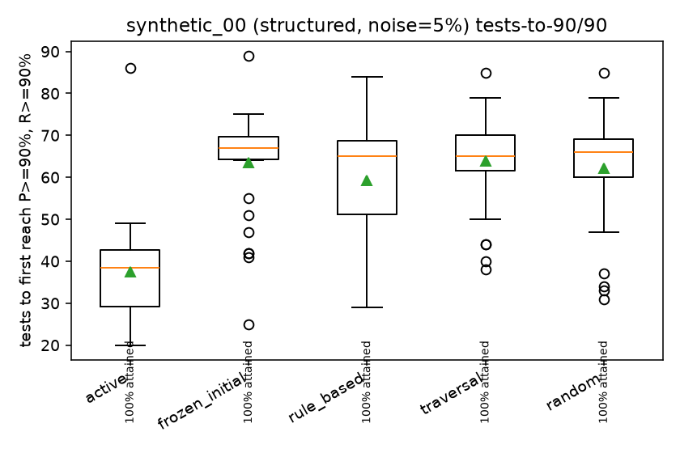

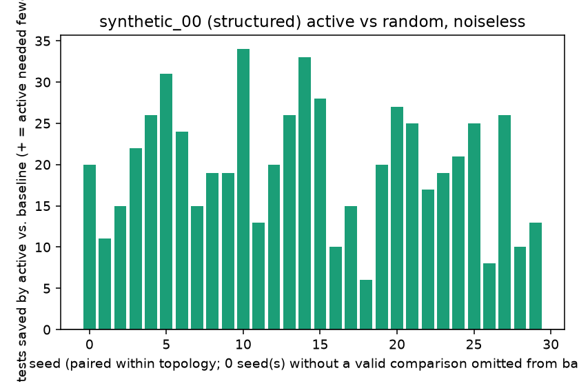

### synthetic_01 (synthetic) -- independent experiment

**noise = 0%**

| policy | first-attain (90/90) | rate | sustained | rate | final P | final R |
|---|---|---|---|---|---|---|
| active | 58 [33-70] tests (n=30) | 100% | 58 [33-70] tests (n=30) | 100% | 1.00 [1.00-1.00] | 1.00 [1.00-1.00] |
| frozen_initial | 58 [33-70] tests (n=30) | 100% | 58 [33-70] tests (n=30) | 100% | 1.00 [1.00-1.00] | 1.00 [1.00-1.00] |
| rule_based | 58 [31-70] tests (n=30) | 100% | 58 [31-70] tests (n=30) | 100% | 1.00 [1.00-1.00] | 1.00 [1.00-1.00] |
| traversal | 68 [45-78] tests (n=30) | 100% | 68 [45-78] tests (n=30) | 100% | 1.00 [1.00-1.00] | 1.00 [1.00-1.00] |
| random | 64 [35-78] tests (n=30) | 100% | 64 [35-78] tests (n=30) | 100% | 1.00 [1.00-1.00] | 1.00 [1.00-1.00] |

**noise = 5%**

| policy | first-attain (90/90) | rate | sustained | rate | final P | final R |
|---|---|---|---|---|---|---|
| active | 74 [55-87] tests (n=28) | 93% | 78 [55-102] tests (n=28) | 93% | 1.00 [0.94-1.00] | 1.00 [0.88-1.00] |
| frozen_initial | 88 [50-99] tests (n=28) | 93% | 91 [56-99] tests (n=28) | 93% | 1.00 [0.94-1.00] | 1.00 [0.88-1.00] |
| rule_based | 88 [47-99] tests (n=28) | 93% | 91 [57-99] tests (n=28) | 93% | 1.00 [0.94-1.00] | 1.00 [0.88-1.00] |
| traversal | 88 [66-100] tests (n=28) | 93% | 90 [66-100] tests (n=28) | 93% | 1.00 [0.94-1.00] | 1.00 [0.88-1.00] |
| random | 88 [58-100] tests (n=28) | 93% | 90 [63-100] tests (n=28) | 93% | 1.00 [0.94-1.00] | 1.00 [0.88-1.00] |

**noise = 15%**

| policy | first-attain (90/90) | rate | sustained | rate | final P | final R |
|---|---|---|---|---|---|---|
| active | 104 [75-252] tests (n=30) | 100% | 117 [77-252] tests (n=28) | 93% | 1.00 [0.89-1.00] | 1.00 [0.88-1.00] |
| frozen_initial | 194 [135-240] tests (n=30) | 100% | 208 [142-264] tests (n=28) | 93% | 1.00 [0.89-1.00] | 1.00 [0.88-1.00] |
| rule_based | 196 [134-239] tests (n=30) | 100% | 208 [141-266] tests (n=28) | 93% | 1.00 [0.89-1.00] | 1.00 [0.88-1.00] |
| traversal | 201 [144-243] tests (n=30) | 100% | 210 [151-264] tests (n=28) | 93% | 1.00 [0.89-1.00] | 1.00 [0.88-1.00] |
| random | 197 [141-240] tests (n=30) | 100% | 210 [148-264] tests (n=28) | 93% | 1.00 [0.89-1.00] | 1.00 [0.88-1.00] |

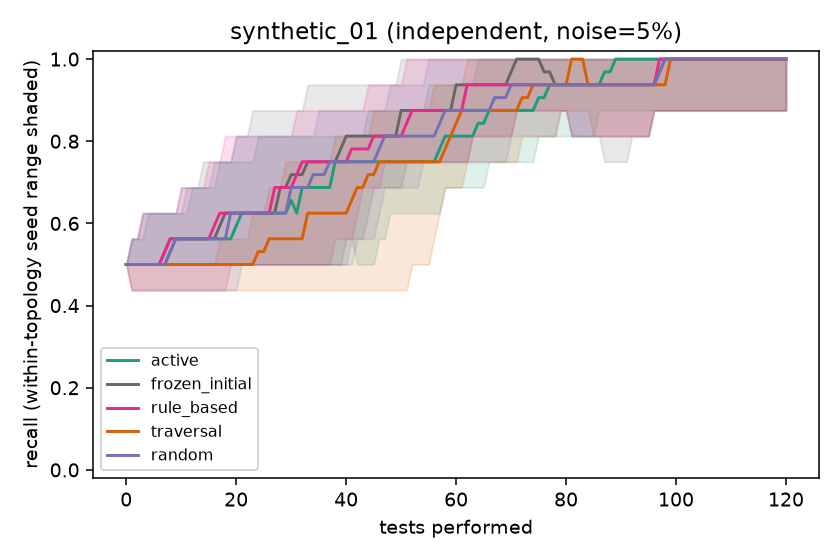
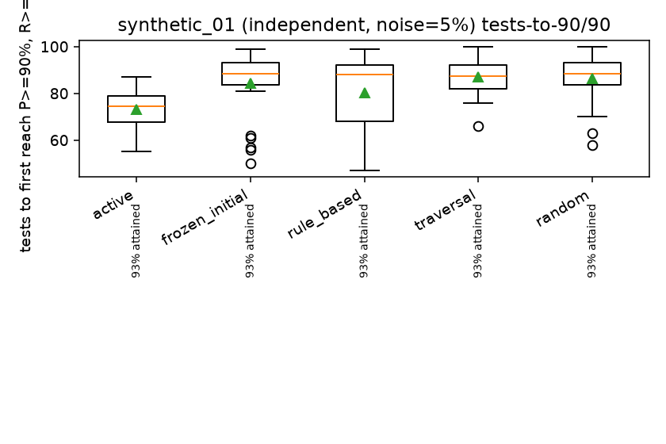

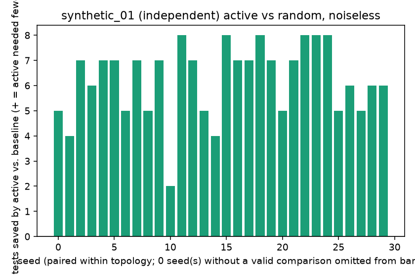

### synthetic_01 (synthetic) -- structured experiment

**noise = 0%**

| policy | first-attain (90/90) | rate | sustained | rate | final P | final R |
|---|---|---|---|---|---|---|
| active | 35 [21-48] tests (n=30) | 100% | 35 [21-48] tests (n=30) | 100% | 1.00 [1.00-1.00] | 1.00 [1.00-1.00] |
| frozen_initial | 58 [33-70] tests (n=30) | 100% | 58 [33-70] tests (n=30) | 100% | 1.00 [1.00-1.00] | 1.00 [1.00-1.00] |
| rule_based | 58 [31-70] tests (n=30) | 100% | 58 [31-70] tests (n=30) | 100% | 1.00 [1.00-1.00] | 1.00 [1.00-1.00] |
| traversal | 68 [45-78] tests (n=30) | 100% | 68 [45-78] tests (n=30) | 100% | 1.00 [1.00-1.00] | 1.00 [1.00-1.00] |
| random | 64 [35-78] tests (n=30) | 100% | 64 [35-78] tests (n=30) | 100% | 1.00 [1.00-1.00] | 1.00 [1.00-1.00] |

**noise = 5%**

| policy | first-attain (90/90) | rate | sustained | rate | final P | final R |
|---|---|---|---|---|---|---|
| active | 52 [35-107] tests (n=29) | 97% | 53 [35-107] tests (n=29) | 97% | 1.00 [0.94-1.00] | 1.00 [0.88-1.00] |
| frozen_initial | 83 [59-99] tests (n=28) | 93% | 84 [61-103] tests (n=28) | 93% | 1.00 [0.94-1.00] | 1.00 [0.88-1.00] |
| rule_based | 82 [31-97] tests (n=28) | 93% | 87 [57-102] tests (n=28) | 93% | 1.00 [0.94-1.00] | 1.00 [0.88-1.00] |
| traversal | 83 [66-102] tests (n=28) | 93% | 86 [66-103] tests (n=28) | 93% | 1.00 [0.94-1.00] | 1.00 [0.88-1.00] |
| random | 84 [58-101] tests (n=28) | 93% | 86 [63-104] tests (n=28) | 93% | 1.00 [0.94-1.00] | 1.00 [0.88-1.00] |

**noise = 15%**

| policy | first-attain (90/90) | rate | sustained | rate | final P | final R |
|---|---|---|---|---|---|---|
| active | 78 [38-140] tests (n=30) | 100% | 83 [38-140] tests (n=29) | 97% | 1.00 [0.94-1.00] | 1.00 [0.88-1.00] |
| frozen_initial | 168 [127-208] tests (n=30) | 100% | 190 [127-232] tests (n=29) | 97% | 1.00 [0.94-1.00] | 1.00 [0.88-1.00] |
| rule_based | 164 [91-205] tests (n=30) | 100% | 185 [91-238] tests (n=29) | 97% | 1.00 [0.94-1.00] | 1.00 [0.88-1.00] |
| traversal | 164 [99-205] tests (n=30) | 100% | 188 [99-232] tests (n=29) | 97% | 1.00 [0.94-1.00] | 1.00 [0.88-1.00] |
| random | 164 [94-205] tests (n=30) | 100% | 185 [94-235] tests (n=29) | 97% | 1.00 [0.94-1.00] | 1.00 [0.88-1.00] |

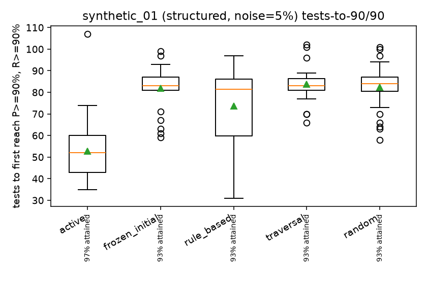

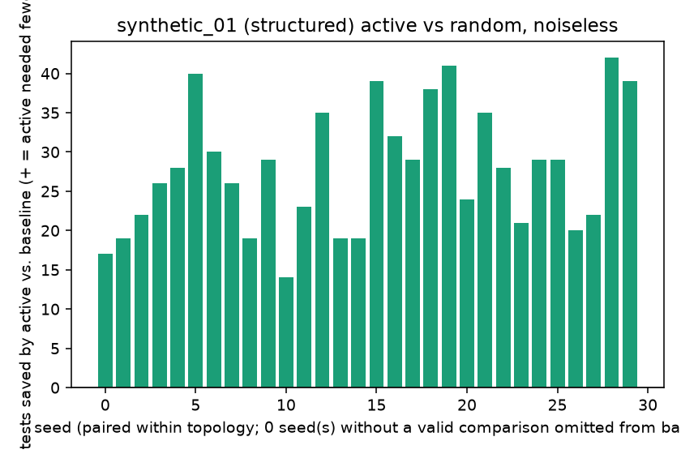

### synthetic_02 (synthetic) -- independent experiment

**noise = 0%**

| policy | first-attain (90/90) | rate | sustained | rate | final P | final R |
|---|---|---|---|---|---|---|
| active | 9 [6-12] tests (n=30) | 100% | 9 [6-12] tests (n=30) | 100% | 1.00 [1.00-1.00] | 1.00 [1.00-1.00] |
| frozen_initial | 9 [6-12] tests (n=30) | 100% | 9 [6-12] tests (n=30) | 100% | 1.00 [1.00-1.00] | 1.00 [1.00-1.00] |
| rule_based | 10 [5-12] tests (n=30) | 100% | 10 [5-12] tests (n=30) | 100% | 1.00 [1.00-1.00] | 1.00 [1.00-1.00] |
| traversal | 13 [11-15] tests (n=30) | 100% | 13 [11-15] tests (n=30) | 100% | 1.00 [1.00-1.00] | 1.00 [1.00-1.00] |
| random | 12 [6-15] tests (n=30) | 100% | 12 [6-15] tests (n=30) | 100% | 1.00 [1.00-1.00] | 1.00 [1.00-1.00] |

**noise = 5%**

| policy | first-attain (90/90) | rate | sustained | rate | final P | final R |
|---|---|---|---|---|---|---|
| active | 11 [6-25] tests (n=29) | 97% | 14 [6-25] tests (n=29) | 97% | 1.00 [0.86-1.00] | 1.00 [1.00-1.00] |
| frozen_initial | 11 [6-28] tests (n=29) | 97% | 19 [6-30] tests (n=29) | 97% | 1.00 [0.86-1.00] | 1.00 [1.00-1.00] |
| rule_based | 11 [5-31] tests (n=29) | 97% | 21 [5-31] tests (n=29) | 97% | 1.00 [0.86-1.00] | 1.00 [1.00-1.00] |
| traversal | 15 [11-29] tests (n=29) | 97% | 16 [11-32] tests (n=29) | 97% | 1.00 [0.86-1.00] | 1.00 [1.00-1.00] |
| random | 15 [6-31] tests (n=29) | 97% | 19 [6-31] tests (n=29) | 97% | 1.00 [0.86-1.00] | 1.00 [1.00-1.00] |

**noise = 15%**

| policy | first-attain (90/90) | rate | sustained | rate | final P | final R |
|---|---|---|---|---|---|---|
| active | 26 [8-58] tests (n=30) | 100% | 34 [9-64] tests (n=28) | 93% | 1.00 [1.00-1.00] | 1.00 [0.83-1.00] |
| frozen_initial | 28 [6-64] tests (n=30) | 100% | 52 [7-69] tests (n=28) | 93% | 1.00 [1.00-1.00] | 1.00 [0.83-1.00] |
| rule_based | 24 [5-64] tests (n=30) | 100% | 52 [6-69] tests (n=28) | 93% | 1.00 [1.00-1.00] | 1.00 [0.83-1.00] |
| traversal | 25 [11-64] tests (n=30) | 100% | 52 [11-69] tests (n=28) | 93% | 1.00 [1.00-1.00] | 1.00 [0.83-1.00] |
| random | 29 [6-64] tests (n=30) | 100% | 52 [8-69] tests (n=28) | 93% | 1.00 [1.00-1.00] | 1.00 [0.83-1.00] |

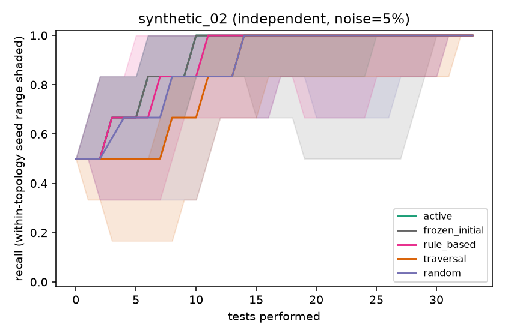
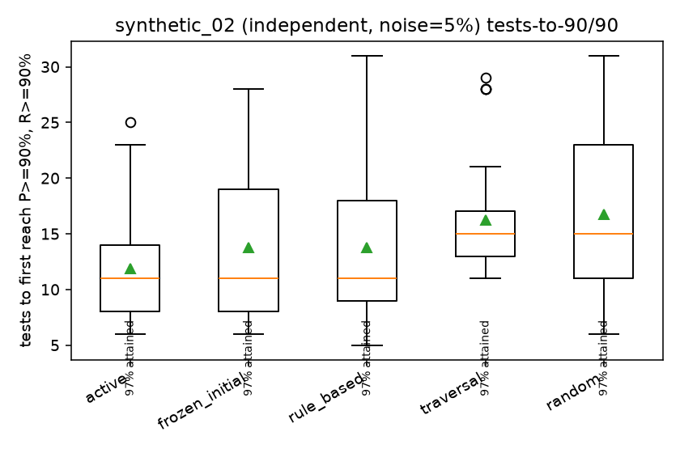

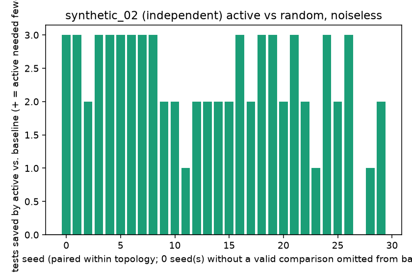

### synthetic_02 (synthetic) -- structured experiment

**noise = 0%**

| policy | first-attain (90/90) | rate | sustained | rate | final P | final R |
|---|---|---|---|---|---|---|
| active | 7 [4-11] tests (n=30) | 100% | 7 [4-11] tests (n=30) | 100% | 1.00 [1.00-1.00] | 1.00 [1.00-1.00] |
| frozen_initial | 9 [6-12] tests (n=30) | 100% | 9 [6-12] tests (n=30) | 100% | 1.00 [1.00-1.00] | 1.00 [1.00-1.00] |
| rule_based | 10 [5-12] tests (n=30) | 100% | 10 [5-12] tests (n=30) | 100% | 1.00 [1.00-1.00] | 1.00 [1.00-1.00] |
| traversal | 13 [11-15] tests (n=30) | 100% | 13 [11-15] tests (n=30) | 100% | 1.00 [1.00-1.00] | 1.00 [1.00-1.00] |
| random | 12 [6-15] tests (n=30) | 100% | 12 [6-15] tests (n=30) | 100% | 1.00 [1.00-1.00] | 1.00 [1.00-1.00] |

**noise = 5%**

| policy | first-attain (90/90) | rate | sustained | rate | final P | final R |
|---|---|---|---|---|---|---|
| active | 7 [3-19] tests (n=30) | 100% | 9 [3-23] tests (n=30) | 100% | 1.00 [1.00-1.00] | 1.00 [1.00-1.00] |
| frozen_initial | 10 [3-29] tests (n=30) | 100% | 16 [3-29] tests (n=30) | 100% | 1.00 [1.00-1.00] | 1.00 [1.00-1.00] |
| rule_based | 10 [5-27] tests (n=30) | 100% | 15 [5-27] tests (n=30) | 100% | 1.00 [1.00-1.00] | 1.00 [1.00-1.00] |
| traversal | 14 [11-30] tests (n=30) | 100% | 16 [11-30] tests (n=30) | 100% | 1.00 [1.00-1.00] | 1.00 [1.00-1.00] |
| random | 14 [6-29] tests (n=30) | 100% | 16 [6-29] tests (n=30) | 100% | 1.00 [1.00-1.00] | 1.00 [1.00-1.00] |

**noise = 15%**

| policy | first-attain (90/90) | rate | sustained | rate | final P | final R |
|---|---|---|---|---|---|---|
| active | 15 [6-42] tests (n=30) | 100% | 19 [6-42] tests (n=30) | 100% | 1.00 [1.00-1.00] | 1.00 [1.00-1.00] |
| frozen_initial | 20 [6-48] tests (n=28) | 93% | 34 [7-48] tests (n=27) | 90% | 1.00 [1.00-1.00] | 1.00 [0.83-1.00] |
| rule_based | 14 [5-49] tests (n=28) | 93% | 34 [6-49] tests (n=27) | 90% | 1.00 [1.00-1.00] | 1.00 [0.83-1.00] |
| traversal | 20 [11-48] tests (n=28) | 93% | 34 [11-53] tests (n=27) | 90% | 1.00 [1.00-1.00] | 1.00 [0.83-1.00] |
| random | 20 [6-48] tests (n=28) | 93% | 34 [8-48] tests (n=27) | 90% | 1.00 [1.00-1.00] | 1.00 [0.83-1.00] |

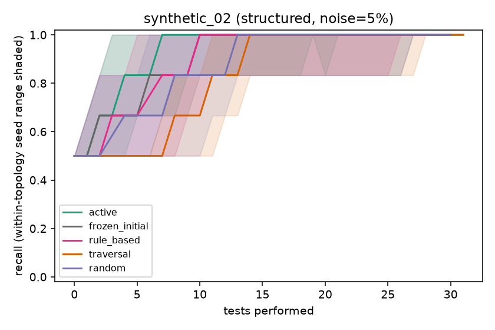
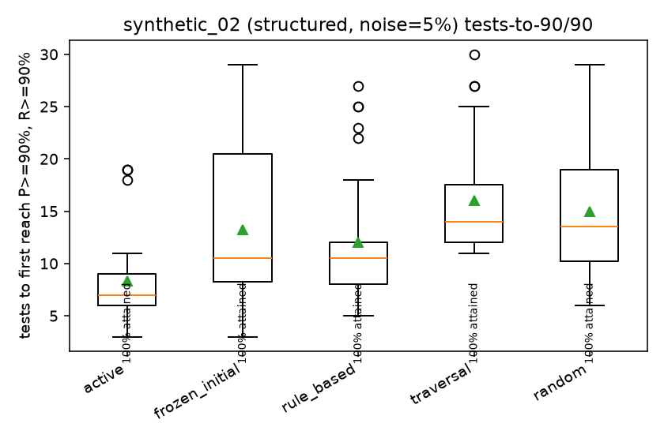

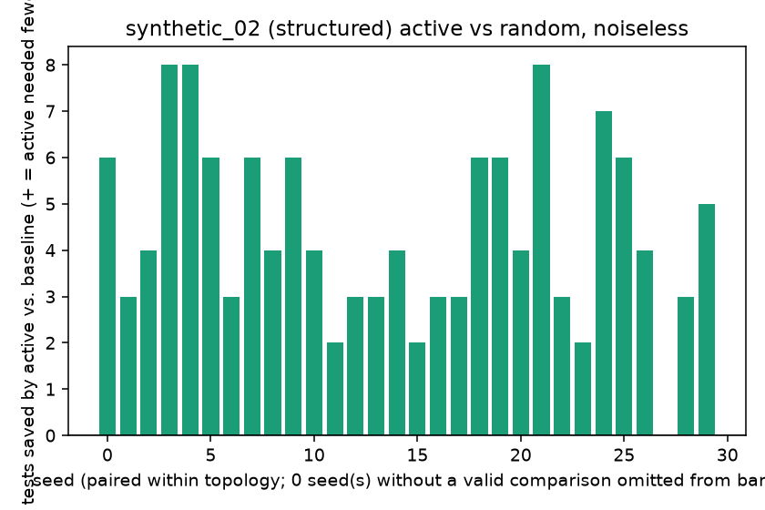

### synthetic_03 (synthetic) -- independent experiment

**noise = 0%**

| policy | first-attain (90/90) | rate | sustained | rate | final P | final R |
|---|---|---|---|---|---|---|
| active | 20 [7-29] tests (n=30) | 100% | 20 [7-29] tests (n=30) | 100% | 1.00 [1.00-1.00] | 1.00 [1.00-1.00] |
| frozen_initial | 20 [7-29] tests (n=30) | 100% | 20 [7-29] tests (n=30) | 100% | 1.00 [1.00-1.00] | 1.00 [1.00-1.00] |
| rule_based | 20 [7-29] tests (n=30) | 100% | 20 [7-29] tests (n=30) | 100% | 1.00 [1.00-1.00] | 1.00 [1.00-1.00] |
| traversal | 26 [16-34] tests (n=30) | 100% | 26 [16-34] tests (n=30) | 100% | 1.00 [1.00-1.00] | 1.00 [1.00-1.00] |
| random | 24 [8-34] tests (n=30) | 100% | 24 [8-34] tests (n=30) | 100% | 1.00 [1.00-1.00] | 1.00 [1.00-1.00] |

**noise = 5%**

| policy | first-attain (90/90) | rate | sustained | rate | final P | final R |
|---|---|---|---|---|---|---|
| active | 28 [10-36] tests (n=30) | 100% | 30 [10-42] tests (n=30) | 100% | 1.00 [1.00-1.00] | 1.00 [0.90-1.00] |
| frozen_initial | 24 [7-50] tests (n=30) | 100% | 33 [7-69] tests (n=30) | 100% | 1.00 [1.00-1.00] | 1.00 [0.90-1.00] |
| rule_based | 26 [7-54] tests (n=30) | 100% | 30 [7-68] tests (n=30) | 100% | 1.00 [1.00-1.00] | 1.00 [0.90-1.00] |
| traversal | 33 [16-51] tests (n=30) | 100% | 34 [16-70] tests (n=30) | 100% | 1.00 [1.00-1.00] | 1.00 [0.90-1.00] |
| random | 32 [8-58] tests (n=30) | 100% | 34 [8-69] tests (n=30) | 100% | 1.00 [1.00-1.00] | 1.00 [0.90-1.00] |

**noise = 15%**

| policy | first-attain (90/90) | rate | sustained | rate | final P | final R |
|---|---|---|---|---|---|---|
| active | 37 [15-76] tests (n=30) | 100% | 40 [17-98] tests (n=30) | 100% | 1.00 [0.91-1.00] | 1.00 [0.90-1.00] |
| frozen_initial | 52 [12-98] tests (n=30) | 100% | 78 [27-107] tests (n=30) | 100% | 1.00 [0.91-1.00] | 1.00 [0.90-1.00] |
| rule_based | 56 [13-98] tests (n=30) | 100% | 79 [28-108] tests (n=30) | 100% | 1.00 [0.91-1.00] | 1.00 [0.90-1.00] |
| traversal | 56 [21-98] tests (n=30) | 100% | 80 [33-107] tests (n=30) | 100% | 1.00 [0.91-1.00] | 1.00 [0.90-1.00] |
| random | 54 [14-98] tests (n=30) | 100% | 80 [32-108] tests (n=30) | 100% | 1.00 [0.91-1.00] | 1.00 [0.90-1.00] |

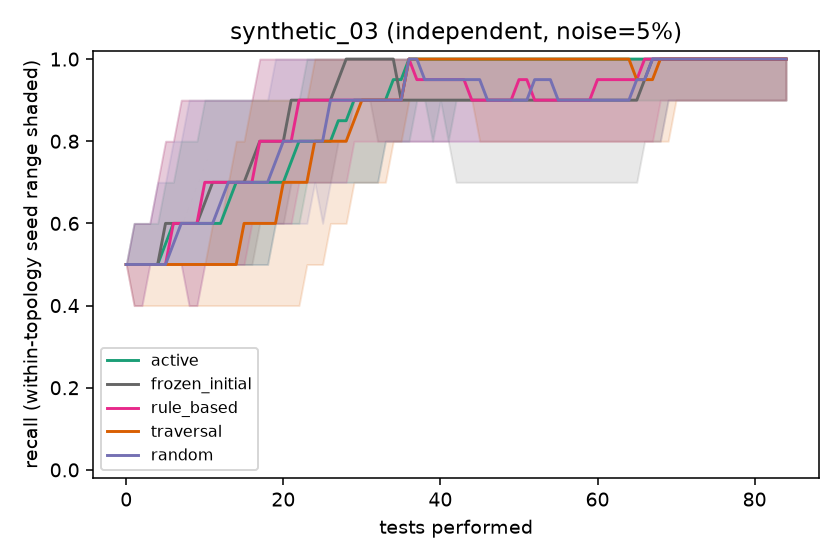
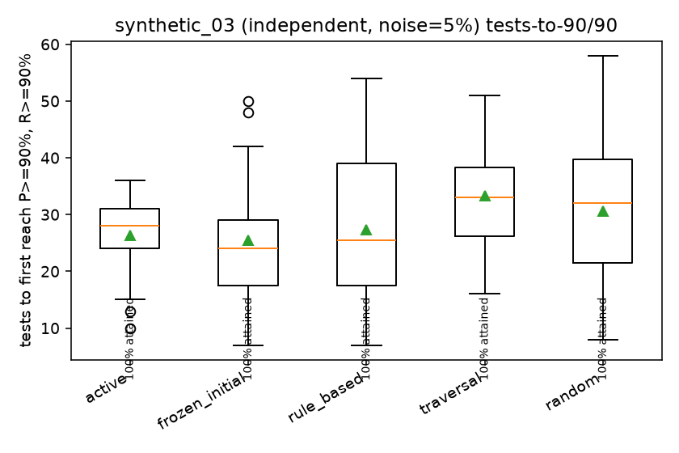

### synthetic_03 (synthetic) -- structured experiment

**noise = 0%**

| policy | first-attain (90/90) | rate | sustained | rate | final P | final R |
|---|---|---|---|---|---|---|
| active | 14 [5-19] tests (n=30) | 100% | 14 [5-19] tests (n=30) | 100% | 1.00 [1.00-1.00] | 1.00 [1.00-1.00] |
| frozen_initial | 20 [7-29] tests (n=30) | 100% | 20 [7-29] tests (n=30) | 100% | 1.00 [1.00-1.00] | 1.00 [1.00-1.00] |
| rule_based | 20 [7-29] tests (n=30) | 100% | 20 [7-29] tests (n=30) | 100% | 1.00 [1.00-1.00] | 1.00 [1.00-1.00] |
| traversal | 26 [16-34] tests (n=30) | 100% | 26 [16-34] tests (n=30) | 100% | 1.00 [1.00-1.00] | 1.00 [1.00-1.00] |
| random | 24 [8-34] tests (n=30) | 100% | 24 [8-34] tests (n=30) | 100% | 1.00 [1.00-1.00] | 1.00 [1.00-1.00] |

**noise = 5%**

| policy | first-attain (90/90) | rate | sustained | rate | final P | final R |
|---|---|---|---|---|---|---|
| active | 18 [12-30] tests (n=30) | 100% | 18 [14-30] tests (n=30) | 100% | 1.00 [1.00-1.00] | 1.00 [0.90-1.00] |
| frozen_initial | 24 [12-48] tests (n=30) | 100% | 26 [12-52] tests (n=30) | 100% | 1.00 [1.00-1.00] | 1.00 [0.90-1.00] |
| rule_based | 23 [7-44] tests (n=30) | 100% | 28 [7-55] tests (n=30) | 100% | 1.00 [1.00-1.00] | 1.00 [0.90-1.00] |
| traversal | 30 [16-45] tests (n=30) | 100% | 32 [16-57] tests (n=30) | 100% | 1.00 [1.00-1.00] | 1.00 [0.90-1.00] |
| random | 27 [8-44] tests (n=30) | 100% | 32 [8-55] tests (n=30) | 100% | 1.00 [1.00-1.00] | 1.00 [0.90-1.00] |

**noise = 15%**

| policy | first-attain (90/90) | rate | sustained | rate | final P | final R |
|---|---|---|---|---|---|---|
| active | 25 [15-57] tests (n=30) | 100% | 28 [18-68] tests (n=30) | 100% | 1.00 [0.91-1.00] | 1.00 [1.00-1.00] |
| frozen_initial | 46 [12-94] tests (n=30) | 100% | 69 [27-101] tests (n=30) | 100% | 1.00 [0.91-1.00] | 1.00 [0.90-1.00] |
| rule_based | 46 [13-93] tests (n=30) | 100% | 68 [28-101] tests (n=30) | 100% | 1.00 [0.91-1.00] | 1.00 [0.90-1.00] |
| traversal | 50 [21-95] tests (n=30) | 100% | 70 [33-101] tests (n=30) | 100% | 1.00 [0.91-1.00] | 1.00 [0.90-1.00] |
| random | 46 [14-94] tests (n=30) | 100% | 69 [32-102] tests (n=30) | 100% | 1.00 [0.91-1.00] | 1.00 [0.90-1.00] |

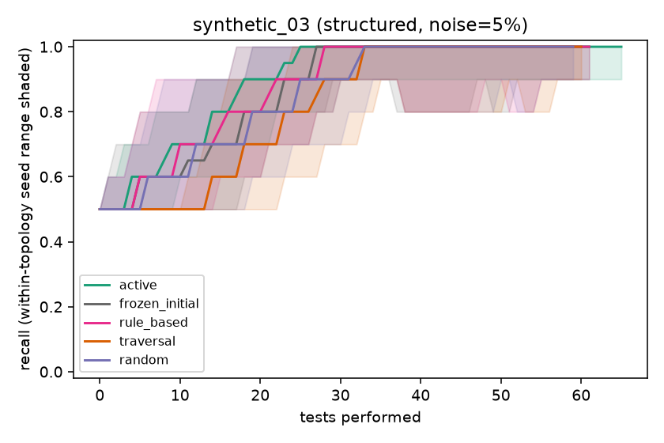
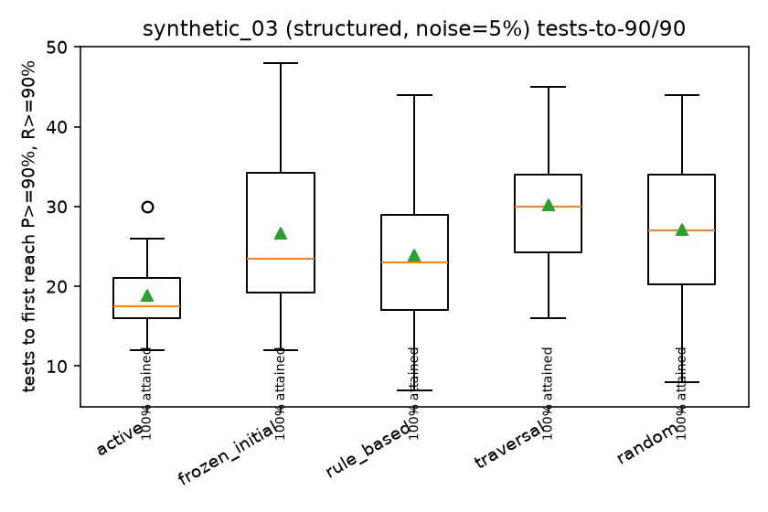

### synthetic_04 (synthetic) -- independent experiment

**noise = 0%**

| policy | first-attain (90/90) | rate | sustained | rate | final P | final R |
|---|---|---|---|---|---|---|
| active | 20 [7-29] tests (n=30) | 100% | 20 [7-29] tests (n=30) | 100% | 1.00 [1.00-1.00] | 1.00 [1.00-1.00] |
| frozen_initial | 20 [7-29] tests (n=30) | 100% | 20 [7-29] tests (n=30) | 100% | 1.00 [1.00-1.00] | 1.00 [1.00-1.00] |
| rule_based | 20 [7-29] tests (n=30) | 100% | 20 [7-29] tests (n=30) | 100% | 1.00 [1.00-1.00] | 1.00 [1.00-1.00] |
| traversal | 26 [16-34] tests (n=30) | 100% | 26 [16-34] tests (n=30) | 100% | 1.00 [1.00-1.00] | 1.00 [1.00-1.00] |
| random | 24 [8-34] tests (n=30) | 100% | 24 [8-34] tests (n=30) | 100% | 1.00 [1.00-1.00] | 1.00 [1.00-1.00] |

**noise = 5%**

| policy | first-attain (90/90) | rate | sustained | rate | final P | final R |
|---|---|---|---|---|---|---|
| active | 26 [12-61] tests (n=30) | 100% | 26 [12-61] tests (n=30) | 100% | 1.00 [1.00-1.00] | 1.00 [1.00-1.00] |
| frozen_initial | 21 [7-68] tests (n=30) | 100% | 34 [7-68] tests (n=30) | 100% | 1.00 [1.00-1.00] | 1.00 [1.00-1.00] |
| rule_based | 22 [7-67] tests (n=30) | 100% | 34 [7-67] tests (n=30) | 100% | 1.00 [1.00-1.00] | 1.00 [1.00-1.00] |
| traversal | 32 [16-68] tests (n=30) | 100% | 36 [16-68] tests (n=30) | 100% | 1.00 [1.00-1.00] | 1.00 [1.00-1.00] |
| random | 26 [8-68] tests (n=30) | 100% | 37 [8-68] tests (n=30) | 100% | 1.00 [1.00-1.00] | 1.00 [1.00-1.00] |

**noise = 15%**

| policy | first-attain (90/90) | rate | sustained | rate | final P | final R |
|---|---|---|---|---|---|---|
| active | 33 [16-78] tests (n=29) | 97% | 42 [17-89] tests (n=29) | 97% | 1.00 [1.00-1.00] | 1.00 [0.80-1.00] |
| frozen_initial | 54 [7-95] tests (n=29) | 97% | 82 [20-113] tests (n=29) | 97% | 1.00 [1.00-1.00] | 1.00 [0.80-1.00] |
| rule_based | 53 [7-100] tests (n=29) | 97% | 82 [19-113] tests (n=29) | 97% | 1.00 [1.00-1.00] | 1.00 [0.80-1.00] |
| traversal | 61 [16-104] tests (n=29) | 97% | 82 [26-113] tests (n=29) | 97% | 1.00 [1.00-1.00] | 1.00 [0.80-1.00] |
| random | 56 [8-96] tests (n=29) | 97% | 83 [23-113] tests (n=29) | 97% | 1.00 [1.00-1.00] | 1.00 [0.80-1.00] |

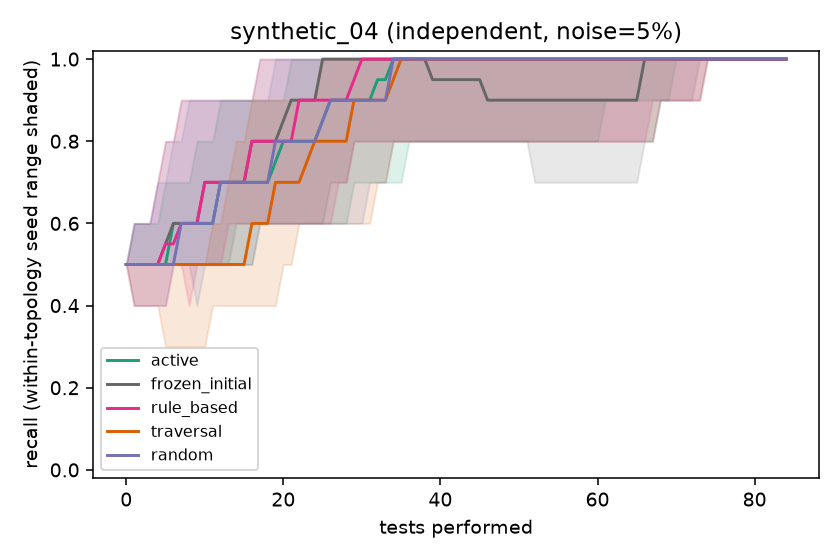
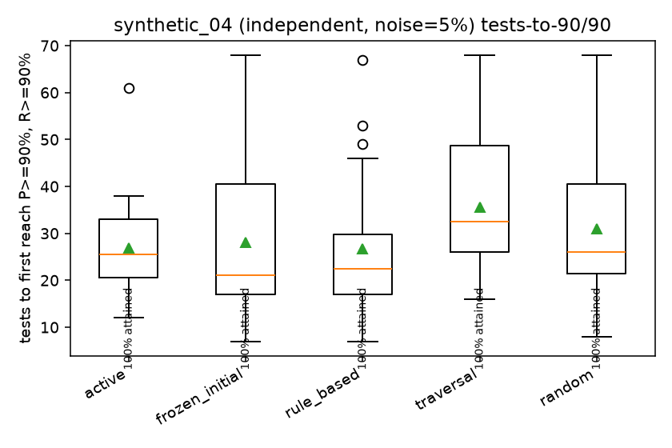

### synthetic_04 (synthetic) -- structured experiment

**noise = 0%**

| policy | first-attain (90/90) | rate | sustained | rate | final P | final R |
|---|---|---|---|---|---|---|
| active | 14 [5-19] tests (n=30) | 100% | 14 [5-19] tests (n=30) | 100% | 1.00 [1.00-1.00] | 1.00 [1.00-1.00] |
| frozen_initial | 20 [7-29] tests (n=30) | 100% | 20 [7-29] tests (n=30) | 100% | 1.00 [1.00-1.00] | 1.00 [1.00-1.00] |
| rule_based | 20 [7-29] tests (n=30) | 100% | 20 [7-29] tests (n=30) | 100% | 1.00 [1.00-1.00] | 1.00 [1.00-1.00] |
| traversal | 26 [16-34] tests (n=30) | 100% | 26 [16-34] tests (n=30) | 100% | 1.00 [1.00-1.00] | 1.00 [1.00-1.00] |
| random | 24 [8-34] tests (n=30) | 100% | 24 [8-34] tests (n=30) | 100% | 1.00 [1.00-1.00] | 1.00 [1.00-1.00] |

**noise = 5%**

| policy | first-attain (90/90) | rate | sustained | rate | final P | final R |
|---|---|---|---|---|---|---|
| active | 17 [11-45] tests (n=30) | 100% | 17 [11-45] tests (n=30) | 100% | 1.00 [0.91-1.00] | 1.00 [0.90-1.00] |
| frozen_initial | 24 [12-54] tests (n=30) | 100% | 30 [12-54] tests (n=30) | 100% | 1.00 [1.00-1.00] | 1.00 [0.90-1.00] |
| rule_based | 21 [7-52] tests (n=30) | 100% | 30 [7-52] tests (n=30) | 100% | 1.00 [1.00-1.00] | 1.00 [0.90-1.00] |
| traversal | 28 [16-51] tests (n=30) | 100% | 34 [16-55] tests (n=30) | 100% | 1.00 [1.00-1.00] | 1.00 [0.90-1.00] |
| random | 26 [8-52] tests (n=30) | 100% | 34 [8-53] tests (n=30) | 100% | 1.00 [1.00-1.00] | 1.00 [0.90-1.00] |

**noise = 15%**

| policy | first-attain (90/90) | rate | sustained | rate | final P | final R |
|---|---|---|---|---|---|---|
| active | 28 [11-79] tests (n=30) | 100% | 29 [11-79] tests (n=30) | 100% | 1.00 [1.00-1.00] | 1.00 [1.00-1.00] |
| frozen_initial | 52 [13-103] tests (n=30) | 100% | 57 [21-103] tests (n=30) | 100% | 1.00 [1.00-1.00] | 1.00 [0.90-1.00] |
| rule_based | 45 [7-94] tests (n=30) | 100% | 53 [20-94] tests (n=30) | 100% | 1.00 [1.00-1.00] | 1.00 [1.00-1.00] |
| traversal | 54 [27-103] tests (n=30) | 100% | 58 [27-103] tests (n=30) | 100% | 1.00 [1.00-1.00] | 1.00 [0.90-1.00] |
| random | 52 [13-103] tests (n=30) | 100% | 57 [24-103] tests (n=30) | 100% | 1.00 [1.00-1.00] | 1.00 [0.90-1.00] |

### synthetic_05 (synthetic) -- independent experiment

**noise = 0%**

| policy | first-attain (90/90) | rate | sustained | rate | final P | final R |
|---|---|---|---|---|---|---|
| active | 30 [18-37] tests (n=30) | 100% | 30 [18-37] tests (n=30) | 100% | 1.00 [1.00-1.00] | 1.00 [1.00-1.00] |
| frozen_initial | 30 [18-37] tests (n=30) | 100% | 30 [18-37] tests (n=30) | 100% | 1.00 [1.00-1.00] | 1.00 [1.00-1.00] |
| rule_based | 30 [17-39] tests (n=30) | 100% | 30 [17-39] tests (n=30) | 100% | 1.00 [1.00-1.00] | 1.00 [1.00-1.00] |
| traversal | 37 [28-45] tests (n=30) | 100% | 37 [28-45] tests (n=30) | 100% | 1.00 [1.00-1.00] | 1.00 [1.00-1.00] |
| random | 34 [19-43] tests (n=30) | 100% | 34 [19-43] tests (n=30) | 100% | 1.00 [1.00-1.00] | 1.00 [1.00-1.00] |

**noise = 5%**

| policy | first-attain (90/90) | rate | sustained | rate | final P | final R |
|---|---|---|---|---|---|---|
| active | 38 [23-55] tests (n=28) | 93% | 39 [23-62] tests (n=28) | 93% | 1.00 [1.00-1.00] | 1.00 [0.83-1.00] |
| frozen_initial | 33 [18-63] tests (n=28) | 93% | 52 [18-68] tests (n=28) | 93% | 1.00 [1.00-1.00] | 1.00 [0.83-1.00] |
| rule_based | 35 [17-63] tests (n=28) | 93% | 52 [17-68] tests (n=28) | 93% | 1.00 [1.00-1.00] | 1.00 [0.83-1.00] |
| traversal | 46 [28-60] tests (n=28) | 93% | 50 [28-68] tests (n=28) | 93% | 1.00 [1.00-1.00] | 1.00 [0.83-1.00] |
| random | 44 [19-63] tests (n=28) | 93% | 52 [19-68] tests (n=28) | 93% | 1.00 [1.00-1.00] | 1.00 [0.83-1.00] |

**noise = 15%**

| policy | first-attain (90/90) | rate | sustained | rate | final P | final R |
|---|---|---|---|---|---|---|
| active | 68 [34-152] tests (n=29) | 97% | 79 [34-152] tests (n=29) | 97% | 1.00 [0.92-1.00] | 1.00 [0.83-1.00] |
| frozen_initial | 122 [67-151] tests (n=29) | 97% | 131 [82-179] tests (n=29) | 97% | 1.00 [0.92-1.00] | 1.00 [0.83-1.00] |
| rule_based | 122 [65-151] tests (n=29) | 97% | 131 [81-179] tests (n=29) | 97% | 1.00 [0.92-1.00] | 1.00 [0.83-1.00] |
| traversal | 126 [76-151] tests (n=29) | 97% | 134 [88-179] tests (n=29) | 97% | 1.00 [0.92-1.00] | 1.00 [0.83-1.00] |
| random | 123 [68-151] tests (n=29) | 97% | 131 [87-179] tests (n=29) | 97% | 1.00 [0.92-1.00] | 1.00 [0.83-1.00] |

### synthetic_05 (synthetic) -- structured experiment

**noise = 0%**

| policy | first-attain (90/90) | rate | sustained | rate | final P | final R |
|---|---|---|---|---|---|---|
| active | 20 [11-26] tests (n=30) | 100% | 20 [11-26] tests (n=30) | 100% | 1.00 [1.00-1.00] | 1.00 [1.00-1.00] |
| frozen_initial | 30 [18-37] tests (n=30) | 100% | 30 [18-37] tests (n=30) | 100% | 1.00 [1.00-1.00] | 1.00 [1.00-1.00] |
| rule_based | 30 [17-39] tests (n=30) | 100% | 30 [17-39] tests (n=30) | 100% | 1.00 [1.00-1.00] | 1.00 [1.00-1.00] |
| traversal | 37 [28-45] tests (n=30) | 100% | 37 [28-45] tests (n=30) | 100% | 1.00 [1.00-1.00] | 1.00 [1.00-1.00] |
| random | 34 [19-43] tests (n=30) | 100% | 34 [19-43] tests (n=30) | 100% | 1.00 [1.00-1.00] | 1.00 [1.00-1.00] |

**noise = 5%**

| policy | first-attain (90/90) | rate | sustained | rate | final P | final R |
|---|---|---|---|---|---|---|
| active | 27 [16-67] tests (n=30) | 100% | 27 [16-67] tests (n=30) | 100% | 1.00 [1.00-1.00] | 1.00 [0.92-1.00] |
| frozen_initial | 35 [16-66] tests (n=29) | 97% | 52 [16-70] tests (n=29) | 97% | 1.00 [1.00-1.00] | 1.00 [0.83-1.00] |
| rule_based | 32 [17-65] tests (n=28) | 93% | 52 [17-69] tests (n=28) | 93% | 1.00 [1.00-1.00] | 1.00 [0.83-1.00] |
| traversal | 41 [28-62] tests (n=29) | 97% | 51 [28-72] tests (n=29) | 97% | 1.00 [1.00-1.00] | 1.00 [0.83-1.00] |
| random | 38 [19-66] tests (n=29) | 97% | 52 [19-69] tests (n=29) | 97% | 1.00 [1.00-1.00] | 1.00 [0.83-1.00] |

**noise = 15%**

| policy | first-attain (90/90) | rate | sustained | rate | final P | final R |
|---|---|---|---|---|---|---|
| active | 50 [32-115] tests (n=30) | 100% | 52 [33-115] tests (n=30) | 100% | 1.00 [0.92-1.00] | 1.00 [0.92-1.00] |
| frozen_initial | 98 [17-146] tests (n=30) | 100% | 116 [65-167] tests (n=30) | 100% | 1.00 [0.92-1.00] | 1.00 [0.92-1.00] |
| rule_based | 96 [23-134] tests (n=29) | 97% | 111 [77-165] tests (n=29) | 97% | 1.00 [0.92-1.00] | 1.00 [0.83-1.00] |
| traversal | 100 [28-145] tests (n=30) | 100% | 112 [83-168] tests (n=30) | 100% | 1.00 [0.92-1.00] | 1.00 [0.92-1.00] |
| random | 97 [28-145] tests (n=30) | 100% | 113 [83-168] tests (n=30) | 100% | 1.00 [0.92-1.00] | 1.00 [0.92-1.00] |

### synthetic_06 (synthetic) -- independent experiment

**noise = 0%**

| policy | first-attain (90/90) | rate | sustained | rate | final P | final R |
|---|---|---|---|---|---|---|
| active | 20 [7-29] tests (n=30) | 100% | 20 [7-29] tests (n=30) | 100% | 1.00 [1.00-1.00] | 1.00 [1.00-1.00] |
| frozen_initial | 20 [7-29] tests (n=30) | 100% | 20 [7-29] tests (n=30) | 100% | 1.00 [1.00-1.00] | 1.00 [1.00-1.00] |
| rule_based | 20 [7-29] tests (n=30) | 100% | 20 [7-29] tests (n=30) | 100% | 1.00 [1.00-1.00] | 1.00 [1.00-1.00] |
| traversal | 26 [16-34] tests (n=30) | 100% | 26 [16-34] tests (n=30) | 100% | 1.00 [1.00-1.00] | 1.00 [1.00-1.00] |
| random | 24 [8-34] tests (n=30) | 100% | 24 [8-34] tests (n=30) | 100% | 1.00 [1.00-1.00] | 1.00 [1.00-1.00] |

**noise = 5%**

| policy | first-attain (90/90) | rate | sustained | rate | final P | final R |
|---|---|---|---|---|---|---|
| active | 26 [10-66] tests (n=29) | 97% | 26 [10-66] tests (n=29) | 97% | 1.00 [1.00-1.00] | 1.00 [0.80-1.00] |
| frozen_initial | 22 [7-70] tests (n=29) | 97% | 28 [12-72] tests (n=29) | 97% | 1.00 [1.00-1.00] | 1.00 [0.80-1.00] |
| rule_based | 23 [7-70] tests (n=29) | 97% | 30 [13-73] tests (n=29) | 97% | 1.00 [1.00-1.00] | 1.00 [0.80-1.00] |
| traversal | 31 [16-70] tests (n=29) | 97% | 35 [21-73] tests (n=29) | 97% | 1.00 [1.00-1.00] | 1.00 [0.80-1.00] |
| random | 27 [8-70] tests (n=29) | 97% | 34 [14-73] tests (n=29) | 97% | 1.00 [1.00-1.00] | 1.00 [0.80-1.00] |

**noise = 15%**

| policy | first-attain (90/90) | rate | sustained | rate | final P | final R |
|---|---|---|---|---|---|---|
| active | 32 [10-99] tests (n=29) | 97% | 42 [17-105] tests (n=29) | 97% | 1.00 [0.91-1.00] | 1.00 [0.80-1.00] |
| frozen_initial | 48 [7-100] tests (n=29) | 97% | 87 [17-125] tests (n=29) | 97% | 1.00 [0.91-1.00] | 1.00 [0.80-1.00] |
| rule_based | 54 [7-102] tests (n=29) | 97% | 86 [17-127] tests (n=29) | 97% | 1.00 [0.91-1.00] | 1.00 [0.80-1.00] |
| traversal | 58 [16-113] tests (n=29) | 97% | 88 [24-121] tests (n=29) | 97% | 1.00 [0.91-1.00] | 1.00 [0.80-1.00] |
| random | 50 [8-103] tests (n=29) | 97% | 87 [20-126] tests (n=29) | 97% | 1.00 [0.91-1.00] | 1.00 [0.80-1.00] |

### synthetic_06 (synthetic) -- structured experiment

**noise = 0%**

| policy | first-attain (90/90) | rate | sustained | rate | final P | final R |
|---|---|---|---|---|---|---|
| active | 14 [5-19] tests (n=30) | 100% | 14 [5-19] tests (n=30) | 100% | 1.00 [1.00-1.00] | 1.00 [1.00-1.00] |
| frozen_initial | 20 [7-29] tests (n=30) | 100% | 20 [7-29] tests (n=30) | 100% | 1.00 [1.00-1.00] | 1.00 [1.00-1.00] |
| rule_based | 20 [7-29] tests (n=30) | 100% | 20 [7-29] tests (n=30) | 100% | 1.00 [1.00-1.00] | 1.00 [1.00-1.00] |
| traversal | 26 [16-34] tests (n=30) | 100% | 26 [16-34] tests (n=30) | 100% | 1.00 [1.00-1.00] | 1.00 [1.00-1.00] |
| random | 24 [8-34] tests (n=30) | 100% | 24 [8-34] tests (n=30) | 100% | 1.00 [1.00-1.00] | 1.00 [1.00-1.00] |

**noise = 5%**

| policy | first-attain (90/90) | rate | sustained | rate | final P | final R |
|---|---|---|---|---|---|---|
| active | 17 [11-46] tests (n=29) | 97% | 17 [11-46] tests (n=29) | 97% | 1.00 [0.89-1.00] | 1.00 [0.80-1.00] |
| frozen_initial | 25 [11-59] tests (n=29) | 97% | 25 [11-59] tests (n=29) | 97% | 1.00 [0.91-1.00] | 1.00 [0.80-1.00] |
| rule_based | 21 [7-53] tests (n=29) | 97% | 27 [13-53] tests (n=29) | 97% | 1.00 [0.91-1.00] | 1.00 [0.80-1.00] |
| traversal | 29 [16-56] tests (n=29) | 97% | 33 [21-56] tests (n=29) | 97% | 1.00 [0.89-1.00] | 1.00 [0.80-1.00] |
| random | 25 [8-54] tests (n=29) | 97% | 31 [14-54] tests (n=29) | 97% | 1.00 [0.91-1.00] | 1.00 [0.80-1.00] |

**noise = 15%**

| policy | first-attain (90/90) | rate | sustained | rate | final P | final R |
|---|---|---|---|---|---|---|
| active | 26 [11-91] tests (n=30) | 100% | 26 [11-91] tests (n=30) | 100% | 1.00 [0.91-1.00] | 1.00 [0.90-1.00] |
| frozen_initial | 44 [7-100] tests (n=29) | 97% | 56 [17-112] tests (n=29) | 97% | 1.00 [0.91-1.00] | 1.00 [0.80-1.00] |
| rule_based | 43 [7-100] tests (n=29) | 97% | 52 [17-112] tests (n=29) | 97% | 1.00 [0.91-1.00] | 1.00 [0.80-1.00] |
| traversal | 48 [16-101] tests (n=29) | 97% | 58 [24-111] tests (n=29) | 97% | 1.00 [0.91-1.00] | 1.00 [0.80-1.00] |
| random | 44 [8-100] tests (n=29) | 97% | 57 [20-112] tests (n=29) | 97% | 1.00 [0.91-1.00] | 1.00 [0.80-1.00] |

### synthetic_07 (synthetic) -- independent experiment

**noise = 0%**

| policy | first-attain (90/90) | rate | sustained | rate | final P | final R |
|---|---|---|---|---|---|---|
| active | 46 [25-54] tests (n=30) | 100% | 46 [25-54] tests (n=30) | 100% | 1.00 [1.00-1.00] | 1.00 [1.00-1.00] |
| frozen_initial | 46 [25-54] tests (n=30) | 100% | 46 [25-54] tests (n=30) | 100% | 1.00 [1.00-1.00] | 1.00 [1.00-1.00] |
| rule_based | 45 [25-53] tests (n=30) | 100% | 45 [25-53] tests (n=30) | 100% | 1.00 [1.00-1.00] | 1.00 [1.00-1.00] |
| traversal | 54 [38-61] tests (n=30) | 100% | 54 [38-61] tests (n=30) | 100% | 1.00 [1.00-1.00] | 1.00 [1.00-1.00] |
| random | 50 [26-60] tests (n=30) | 100% | 50 [26-60] tests (n=30) | 100% | 1.00 [1.00-1.00] | 1.00 [1.00-1.00] |

**noise = 5%**

| policy | first-attain (90/90) | rate | sustained | rate | final P | final R |
|---|---|---|---|---|---|---|
| active | 58 [34-68] tests (n=29) | 97% | 59 [39-84] tests (n=29) | 97% | 1.00 [1.00-1.00] | 1.00 [0.86-1.00] |
| frozen_initial | 55 [32-77] tests (n=29) | 97% | 70 [32-84] tests (n=29) | 97% | 1.00 [1.00-1.00] | 1.00 [0.86-1.00] |
| rule_based | 52 [29-77] tests (n=29) | 97% | 69 [34-84] tests (n=29) | 97% | 1.00 [1.00-1.00] | 1.00 [0.86-1.00] |
| traversal | 64 [44-80] tests (n=29) | 97% | 68 [44-84] tests (n=29) | 97% | 1.00 [1.00-1.00] | 1.00 [0.86-1.00] |
| random | 64 [36-77] tests (n=29) | 97% | 68 [36-84] tests (n=29) | 97% | 1.00 [1.00-1.00] | 1.00 [0.86-1.00] |

**noise = 15%**

| policy | first-attain (90/90) | rate | sustained | rate | final P | final R |
|---|---|---|---|---|---|---|
| active | 98 [55-166] tests (n=30) | 100% | 106 [55-166] tests (n=30) | 100% | 1.00 [1.00-1.00] | 1.00 [0.93-1.00] |
| frozen_initial | 160 [100-200] tests (n=30) | 100% | 166 [100-200] tests (n=30) | 100% | 1.00 [1.00-1.00] | 1.00 [0.93-1.00] |
| rule_based | 160 [101-199] tests (n=30) | 100% | 168 [101-199] tests (n=30) | 100% | 1.00 [1.00-1.00] | 1.00 [0.93-1.00] |
| traversal | 164 [110-200] tests (n=30) | 100% | 170 [110-200] tests (n=30) | 100% | 1.00 [1.00-1.00] | 1.00 [0.93-1.00] |
| random | 162 [105-200] tests (n=30) | 100% | 169 [105-200] tests (n=30) | 100% | 1.00 [1.00-1.00] | 1.00 [0.93-1.00] |

### synthetic_07 (synthetic) -- structured experiment

**noise = 0%**

| policy | first-attain (90/90) | rate | sustained | rate | final P | final R |
|---|---|---|---|---|---|---|
| active | 27 [14-39] tests (n=30) | 100% | 27 [14-39] tests (n=30) | 100% | 1.00 [1.00-1.00] | 1.00 [1.00-1.00] |
| frozen_initial | 46 [25-54] tests (n=30) | 100% | 46 [25-54] tests (n=30) | 100% | 1.00 [1.00-1.00] | 1.00 [1.00-1.00] |
| rule_based | 45 [25-53] tests (n=30) | 100% | 45 [25-53] tests (n=30) | 100% | 1.00 [1.00-1.00] | 1.00 [1.00-1.00] |
| traversal | 54 [38-61] tests (n=30) | 100% | 54 [38-61] tests (n=30) | 100% | 1.00 [1.00-1.00] | 1.00 [1.00-1.00] |
| random | 50 [26-60] tests (n=30) | 100% | 50 [26-60] tests (n=30) | 100% | 1.00 [1.00-1.00] | 1.00 [1.00-1.00] |

**noise = 5%**

| policy | first-attain (90/90) | rate | sustained | rate | final P | final R |
|---|---|---|---|---|---|---|
| active | 37 [24-65] tests (n=29) | 97% | 37 [24-65] tests (n=29) | 97% | 1.00 [1.00-1.00] | 1.00 [0.86-1.00] |
| frozen_initial | 55 [33-81] tests (n=29) | 97% | 66 [40-81] tests (n=29) | 97% | 1.00 [1.00-1.00] | 1.00 [0.86-1.00] |
| rule_based | 51 [29-78] tests (n=29) | 97% | 68 [34-80] tests (n=29) | 97% | 1.00 [1.00-1.00] | 1.00 [0.86-1.00] |
| traversal | 61 [44-82] tests (n=29) | 97% | 68 [44-83] tests (n=29) | 97% | 1.00 [1.00-1.00] | 1.00 [0.86-1.00] |
| random | 59 [36-79] tests (n=29) | 97% | 67 [36-83] tests (n=29) | 97% | 1.00 [1.00-1.00] | 1.00 [0.86-1.00] |

**noise = 15%**

| policy | first-attain (90/90) | rate | sustained | rate | final P | final R |
|---|---|---|---|---|---|---|
| active | 66 [30-94] tests (n=30) | 100% | 68 [30-134] tests (n=30) | 100% | 1.00 [1.00-1.00] | 1.00 [0.93-1.00] |
| frozen_initial | 132 [79-173] tests (n=30) | 100% | 144 [82-173] tests (n=30) | 100% | 1.00 [1.00-1.00] | 1.00 [0.93-1.00] |
| rule_based | 133 [69-174] tests (n=30) | 100% | 144 [69-176] tests (n=30) | 100% | 1.00 [1.00-1.00] | 1.00 [0.93-1.00] |
| traversal | 136 [77-174] tests (n=30) | 100% | 146 [77-174] tests (n=30) | 100% | 1.00 [1.00-1.00] | 1.00 [0.93-1.00] |
| random | 134 [69-174] tests (n=30) | 100% | 144 [69-174] tests (n=30) | 100% | 1.00 [1.00-1.00] | 1.00 [0.93-1.00] |

### synthetic_08 (synthetic) -- independent experiment

**noise = 0%**

| policy | first-attain (90/90) | rate | sustained | rate | final P | final R |
|---|---|---|---|---|---|---|
| active | 30 [18-37] tests (n=30) | 100% | 30 [18-37] tests (n=30) | 100% | 1.00 [1.00-1.00] | 1.00 [1.00-1.00] |
| frozen_initial | 30 [18-37] tests (n=30) | 100% | 30 [18-37] tests (n=30) | 100% | 1.00 [1.00-1.00] | 1.00 [1.00-1.00] |
| rule_based | 30 [17-39] tests (n=30) | 100% | 30 [17-39] tests (n=30) | 100% | 1.00 [1.00-1.00] | 1.00 [1.00-1.00] |
| traversal | 37 [28-45] tests (n=30) | 100% | 37 [28-45] tests (n=30) | 100% | 1.00 [1.00-1.00] | 1.00 [1.00-1.00] |
| random | 34 [19-43] tests (n=30) | 100% | 34 [19-43] tests (n=30) | 100% | 1.00 [1.00-1.00] | 1.00 [1.00-1.00] |

**noise = 5%**

| policy | first-attain (90/90) | rate | sustained | rate | final P | final R |
|---|---|---|---|---|---|---|
| active | 38 [22-58] tests (n=29) | 97% | 38 [22-58] tests (n=29) | 97% | 1.00 [1.00-1.00] | 1.00 [0.83-1.00] |
| frozen_initial | 34 [18-65] tests (n=29) | 97% | 51 [18-67] tests (n=29) | 97% | 1.00 [1.00-1.00] | 1.00 [0.83-1.00] |
| rule_based | 39 [17-65] tests (n=29) | 97% | 51 [17-67] tests (n=29) | 97% | 1.00 [1.00-1.00] | 1.00 [0.83-1.00] |
| traversal | 45 [28-65] tests (n=29) | 97% | 49 [28-67] tests (n=29) | 97% | 1.00 [1.00-1.00] | 1.00 [0.83-1.00] |
| random | 43 [19-65] tests (n=29) | 97% | 51 [19-67] tests (n=29) | 97% | 1.00 [1.00-1.00] | 1.00 [0.83-1.00] |

**noise = 15%**

| policy | first-attain (90/90) | rate | sustained | rate | final P | final R |
|---|---|---|---|---|---|---|
| active | 63 [39-156] tests (n=30) | 100% | 70 [39-156] tests (n=30) | 100% | 1.00 [0.92-1.00] | 1.00 [0.92-1.00] |
| frozen_initial | 114 [67-169] tests (n=30) | 100% | 123 [67-169] tests (n=30) | 100% | 1.00 [0.92-1.00] | 1.00 [0.92-1.00] |
| rule_based | 115 [65-169] tests (n=30) | 100% | 124 [65-169] tests (n=30) | 100% | 1.00 [0.92-1.00] | 1.00 [0.92-1.00] |
| traversal | 111 [76-169] tests (n=30) | 100% | 125 [76-169] tests (n=30) | 100% | 1.00 [0.92-1.00] | 1.00 [0.92-1.00] |
| random | 114 [68-169] tests (n=30) | 100% | 124 [68-169] tests (n=30) | 100% | 1.00 [0.92-1.00] | 1.00 [0.92-1.00] |

### synthetic_08 (synthetic) -- structured experiment

**noise = 0%**

| policy | first-attain (90/90) | rate | sustained | rate | final P | final R |
|---|---|---|---|---|---|---|
| active | 20 [11-26] tests (n=30) | 100% | 20 [11-26] tests (n=30) | 100% | 1.00 [1.00-1.00] | 1.00 [1.00-1.00] |
| frozen_initial | 30 [18-37] tests (n=30) | 100% | 30 [18-37] tests (n=30) | 100% | 1.00 [1.00-1.00] | 1.00 [1.00-1.00] |
| rule_based | 30 [17-39] tests (n=30) | 100% | 30 [17-39] tests (n=30) | 100% | 1.00 [1.00-1.00] | 1.00 [1.00-1.00] |
| traversal | 37 [28-45] tests (n=30) | 100% | 37 [28-45] tests (n=30) | 100% | 1.00 [1.00-1.00] | 1.00 [1.00-1.00] |
| random | 34 [19-43] tests (n=30) | 100% | 34 [19-43] tests (n=30) | 100% | 1.00 [1.00-1.00] | 1.00 [1.00-1.00] |

**noise = 5%**

| policy | first-attain (90/90) | rate | sustained | rate | final P | final R |
|---|---|---|---|---|---|---|
| active | 26 [13-68] tests (n=30) | 100% | 26 [13-68] tests (n=30) | 100% | 1.00 [1.00-1.00] | 1.00 [0.92-1.00] |
| frozen_initial | 38 [18-64] tests (n=29) | 97% | 50 [22-64] tests (n=29) | 97% | 1.00 [0.91-1.00] | 1.00 [0.83-1.00] |
| rule_based | 33 [17-62] tests (n=29) | 97% | 51 [17-64] tests (n=29) | 97% | 1.00 [0.91-1.00] | 1.00 [0.83-1.00] |
| traversal | 42 [28-65] tests (n=29) | 97% | 49 [28-66] tests (n=29) | 97% | 1.00 [0.91-1.00] | 1.00 [0.83-1.00] |
| random | 39 [19-64] tests (n=29) | 97% | 51 [19-65] tests (n=29) | 97% | 1.00 [0.91-1.00] | 1.00 [0.83-1.00] |

**noise = 15%**

| policy | first-attain (90/90) | rate | sustained | rate | final P | final R |
|---|---|---|---|---|---|---|
| active | 39 [27-118] tests (n=30) | 100% | 42 [27-118] tests (n=30) | 100% | 1.00 [0.92-1.00] | 1.00 [0.92-1.00] |
| frozen_initial | 86 [35-152] tests (n=30) | 100% | 96 [49-155] tests (n=30) | 100% | 1.00 [0.92-1.00] | 1.00 [0.92-1.00] |
| rule_based | 93 [31-148] tests (n=30) | 100% | 96 [49-155] tests (n=30) | 100% | 1.00 [0.92-1.00] | 1.00 [0.92-1.00] |
| traversal | 94 [55-148] tests (n=30) | 100% | 97 [55-155] tests (n=30) | 100% | 1.00 [0.92-1.00] | 1.00 [0.92-1.00] |
| random | 93 [35-148] tests (n=30) | 100% | 97 [49-155] tests (n=30) | 100% | 1.00 [0.92-1.00] | 1.00 [0.92-1.00] |

### synthetic_09 (synthetic) -- independent experiment

**noise = 0%**

| policy | first-attain (90/90) | rate | sustained | rate | final P | final R |
|---|---|---|---|---|---|---|
| active | 73 [39-88] tests (n=30) | 100% | 73 [39-88] tests (n=30) | 100% | 1.00 [1.00-1.00] | 1.00 [1.00-1.00] |
| frozen_initial | 73 [39-88] tests (n=30) | 100% | 73 [39-88] tests (n=30) | 100% | 1.00 [1.00-1.00] | 1.00 [1.00-1.00] |
| rule_based | 73 [39-88] tests (n=30) | 100% | 73 [39-88] tests (n=30) | 100% | 1.00 [1.00-1.00] | 1.00 [1.00-1.00] |
| traversal | 82 [51-97] tests (n=30) | 100% | 82 [51-97] tests (n=30) | 100% | 1.00 [1.00-1.00] | 1.00 [1.00-1.00] |
| random | 80 [45-97] tests (n=30) | 100% | 80 [45-97] tests (n=30) | 100% | 1.00 [1.00-1.00] | 1.00 [1.00-1.00] |

**noise = 5%**

| policy | first-attain (90/90) | rate | sustained | rate | final P | final R |
|---|---|---|---|---|---|---|
| active | 90 [49-109] tests (n=30) | 100% | 94 [60-132] tests (n=30) | 100% | 1.00 [0.95-1.00] | 1.00 [0.94-1.00] |
| frozen_initial | 107 [60-131] tests (n=30) | 100% | 112 [72-131] tests (n=30) | 100% | 1.00 [0.95-1.00] | 1.00 [0.94-1.00] |
| rule_based | 108 [62-131] tests (n=30) | 100% | 112 [68-131] tests (n=30) | 100% | 1.00 [0.95-1.00] | 1.00 [0.94-1.00] |
| traversal | 107 [82-130] tests (n=30) | 100% | 108 [82-130] tests (n=30) | 100% | 1.00 [0.95-1.00] | 1.00 [0.94-1.00] |
| random | 108 [68-131] tests (n=30) | 100% | 110 [78-131] tests (n=30) | 100% | 1.00 [0.95-1.00] | 1.00 [0.94-1.00] |

**noise = 15%**

| policy | first-attain (90/90) | rate | sustained | rate | final P | final R |
|---|---|---|---|---|---|---|
| active | 131 [84-306] tests (n=29) | 97% | 167 [84-306] tests (n=29) | 97% | 1.00 [0.89-1.00] | 1.00 [0.94-1.00] |
| frozen_initial | 253 [148-306] tests (n=30) | 100% | 276 [148-319] tests (n=29) | 97% | 1.00 [0.89-1.00] | 1.00 [0.94-1.00] |
| rule_based | 252 [148-307] tests (n=30) | 100% | 276 [148-309] tests (n=29) | 97% | 1.00 [0.89-1.00] | 1.00 [0.94-1.00] |
| traversal | 258 [162-305] tests (n=30) | 100% | 275 [162-311] tests (n=29) | 97% | 1.00 [0.89-1.00] | 1.00 [0.94-1.00] |
| random | 255 [152-306] tests (n=30) | 100% | 276 [152-311] tests (n=29) | 97% | 1.00 [0.89-1.00] | 1.00 [0.94-1.00] |

### synthetic_09 (synthetic) -- structured experiment

**noise = 0%**

| policy | first-attain (90/90) | rate | sustained | rate | final P | final R |
|---|---|---|---|---|---|---|
| active | 42 [28-55] tests (n=30) | 100% | 42 [28-55] tests (n=30) | 100% | 1.00 [1.00-1.00] | 1.00 [1.00-1.00] |
| frozen_initial | 73 [39-88] tests (n=30) | 100% | 73 [39-88] tests (n=30) | 100% | 1.00 [1.00-1.00] | 1.00 [1.00-1.00] |
| rule_based | 73 [39-88] tests (n=30) | 100% | 73 [39-88] tests (n=30) | 100% | 1.00 [1.00-1.00] | 1.00 [1.00-1.00] |
| traversal | 82 [51-97] tests (n=30) | 100% | 82 [51-97] tests (n=30) | 100% | 1.00 [1.00-1.00] | 1.00 [1.00-1.00] |
| random | 80 [45-97] tests (n=30) | 100% | 80 [45-97] tests (n=30) | 100% | 1.00 [1.00-1.00] | 1.00 [1.00-1.00] |

**noise = 5%**

| policy | first-attain (90/90) | rate | sustained | rate | final P | final R |
|---|---|---|---|---|---|---|
| active | 62 [38-110] tests (n=30) | 100% | 62 [38-110] tests (n=30) | 100% | 1.00 [0.95-1.00] | 1.00 [0.94-1.00] |
| frozen_initial | 104 [67-120] tests (n=30) | 100% | 105 [74-129] tests (n=30) | 100% | 1.00 [0.95-1.00] | 1.00 [0.94-1.00] |
| rule_based | 103 [62-115] tests (n=30) | 100% | 105 [62-127] tests (n=30) | 100% | 1.00 [0.95-1.00] | 1.00 [0.94-1.00] |
| traversal | 103 [75-117] tests (n=30) | 100% | 106 [75-127] tests (n=30) | 100% | 1.00 [0.95-1.00] | 1.00 [0.94-1.00] |
| random | 104 [68-116] tests (n=30) | 100% | 105 [68-127] tests (n=30) | 100% | 1.00 [0.95-1.00] | 1.00 [0.94-1.00] |

**noise = 15%**

| policy | first-attain (90/90) | rate | sustained | rate | final P | final R |
|---|---|---|---|---|---|---|
| active | 113 [53-177] tests (n=30) | 100% | 116 [53-209] tests (n=30) | 100% | 1.00 [0.94-1.00] | 1.00 [0.94-1.00] |
| frozen_initial | 220 [127-269] tests (n=30) | 100% | 228 [127-279] tests (n=30) | 100% | 1.00 [0.94-1.00] | 1.00 [0.94-1.00] |
| rule_based | 216 [126-272] tests (n=30) | 100% | 230 [126-295] tests (n=30) | 100% | 1.00 [0.94-1.00] | 1.00 [0.94-1.00] |
| traversal | 218 [137-272] tests (n=30) | 100% | 232 [137-276] tests (n=30) | 100% | 1.00 [0.94-1.00] | 1.00 [0.94-1.00] |
| random | 215 [128-272] tests (n=30) | 100% | 230 [128-275] tests (n=30) | 100% | 1.00 [0.94-1.00] | 1.00 [0.94-1.00] |

### Topologies excluded from the `feeds` benchmark

- **fcu**: zero candidate coverage (entities likely missing rdf:type metadata needed for subclass-based candidate generation) (1 true edge(s), 0 candidate(s) generated).
- **chiller_plant**: no asserted edges for this relation (0 true edge(s), 0 candidate(s) generated).
- **boiler_plant**: no asserted edges for this relation (0 true edge(s), 0 candidate(s) generated).
- **sfpu**: structural duplicate of pfpu (excluded from all experiments) (0 true edge(s), 0 candidate(s) generated).

## Secondary benchmarks: `hasPoint`, `hasPart`

Evaluated independently from `feeds`; only the independent-edge experiment is run here (structured beliefs are defined only for `feeds` terminal-unit/zone targets). Reported as final precision/recall/F1 (median [range] across seeds) at noise=5%, active policy, since the point of this section is coverage/availability rather than a full policy comparison.

### `hasPoint`

| building_id | available? | reason | final P | final R | final F1 |
|---|---|---|---|---|---|
| sdahu | yes | -- | 1.00 [0.96-1.00] | 0.88 [0.73-0.93] | 0.93 [0.85-0.97] |
| ddahu | yes | -- | 1.00 [0.97-1.00] | 0.93 [0.88-0.96] | 0.96 [0.93-0.98] |
| rtu_exp | yes | -- | 1.00 [0.98-1.00] | 0.74 [0.69-0.78] | 0.85 [0.82-0.88] |
| rtu_sim | yes | -- | 1.00 [1.00-1.00] | 0.79 [0.71-0.79] | 0.88 [0.83-0.88] |
| fcu | no | zero candidate coverage (entities likely missing rdf:type metadata needed for subclass-based candidate generation) | -- | -- | -- |
| chiller_plant | yes | -- | 1.00 [0.98-1.00] | 0.56 [0.52-0.59] | 0.72 [0.68-0.75] |
| boiler_plant | yes | -- | 1.00 [0.92-1.00] | 0.55 [0.55-0.55] | 0.71 [0.69-0.71] |
| pfpu | yes | -- | 1.00 [0.98-1.00] | 0.91 [0.86-0.94] | 0.95 [0.92-0.97] |
| sfpu | no | structural duplicate of pfpu (excluded from all experiments) | -- | -- | -- |

### `hasPart`

| building_id | available? | reason | final P | final R | final F1 |
|---|---|---|---|---|---|
| sdahu | yes | -- | 1.00 [1.00-1.00] | 1.00 [0.80-1.00] | 1.00 [0.89-1.00] |
| ddahu | yes | -- | 1.00 [0.94-1.00] | 0.94 [0.83-1.00] | 0.97 [0.91-1.00] |
| rtu_exp | yes | -- | 1.00 [0.67-1.00] | 1.00 [0.50-1.00] | 1.00 [0.67-1.00] |
| rtu_sim | yes | -- | 1.00 [1.00-1.00] | 1.00 [0.67-1.00] | 1.00 [0.80-1.00] |
| fcu | no | zero candidate coverage (entities likely missing rdf:type metadata needed for subclass-based candidate generation) | -- | -- | -- |
| chiller_plant | no | zero candidate coverage (entities likely missing rdf:type metadata needed for subclass-based candidate generation) | -- | -- | -- |
| boiler_plant | no | zero candidate coverage (entities likely missing rdf:type metadata needed for subclass-based candidate generation) | -- | -- | -- |
| pfpu | yes | -- | 1.00 [0.95-1.00] | 0.95 [0.89-1.00] | 0.97 [0.94-1.00] |
| sfpu | no | structural duplicate of pfpu (excluded from all experiments) | -- | -- | -- |

## Ablations (representative subset only)

Run on rtu_exp, sdahu only, to bound total compute; not a full per-topology ablation grid.

### Uniform-prior ablation (independent experiment, active policy)

| building_id | noise | prior | first-attain (90/90) | rate |
|---|---|---|---|---|
| rtu_exp | 0% | sparse | 90 [66-117] tests (n=30) | 100% |
| rtu_exp | 0% | uniform | 107 [85-118] tests (n=30) | 100% |
| rtu_exp | 5% | sparse | 111 [78-140] tests (n=30) | 100% |
| rtu_exp | 5% | uniform | 244 [85-263] tests (n=30) | 100% |
| rtu_exp | 15% | sparse | 160 [111-308] tests (n=30) | 100% |
| rtu_exp | 15% | uniform | 335 [271-393] tests (n=29) | 97% |
| sdahu | 0% | sparse | 0 [0-0] tests (n=30) | 100% |
| sdahu | 0% | uniform | 5 [5-5] tests (n=30) | 100% |
| sdahu | 5% | sparse | 0 [0-0] tests (n=30) | 100% |
| sdahu | 5% | uniform | 5 [5-7] tests (n=30) | 100% |
| sdahu | 15% | sparse | 0 [0-0] tests (n=30) | 100% |
| sdahu | 15% | uniform | 5 [5-13] tests (n=28) | 93% |

### Structured cardinality sensitivity (lambda)

| building_id | noise | lambda | first-attain (90/90) | rate | parent-count violations |
|---|---|---|---|---|---|
| rtu_exp | 0% | 0.0 | 94 [88-98] tests (n=30) | 100% | 0 |
| rtu_exp | 0% | 0.5 | 48 [34-64] tests (n=30) | 100% | 0 |
| rtu_exp | 0% | 1.0 | 48 [34-64] tests (n=30) | 100% | 0 |
| rtu_exp | 0% | 2.0 | 48 [34-64] tests (n=30) | 100% | 0 |
| rtu_exp | 5% | 0.0 | 116 [100-140] tests (n=30) | 100% | 0 |
| rtu_exp | 5% | 0.5 | 63 [37-99] tests (n=30) | 100% | 0 |
| rtu_exp | 5% | 1.0 | 62 [43-99] tests (n=30) | 100% | 0 |
| rtu_exp | 5% | 2.0 | 60 [43-89] tests (n=30) | 100% | 0 |
| rtu_exp | 15% | 0.0 | 165 [135-304] tests (n=30) | 100% | 0 |
| rtu_exp | 15% | 0.5 | 105 [54-232] tests (n=30) | 100% | 0 |
| rtu_exp | 15% | 1.0 | 106 [56-228] tests (n=30) | 100% | 0 |
| rtu_exp | 15% | 2.0 | 110 [56-175] tests (n=30) | 100% | 0 |
| sdahu | 0% | 0.0 | 0 [0-0] tests (n=30) | 100% | 0 |
| sdahu | 0% | 0.5 | 0 [0-0] tests (n=30) | 100% | 0 |
| sdahu | 0% | 1.0 | 0 [0-0] tests (n=30) | 100% | 0 |
| sdahu | 0% | 2.0 | 0 [0-0] tests (n=30) | 100% | 0 |
| sdahu | 5% | 0.0 | 0 [0-0] tests (n=30) | 100% | 0 |
| sdahu | 5% | 0.5 | 0 [0-0] tests (n=30) | 100% | 0 |
| sdahu | 5% | 1.0 | 0 [0-0] tests (n=30) | 100% | 0 |
| sdahu | 5% | 2.0 | 0 [0-0] tests (n=30) | 100% | 0 |
| sdahu | 15% | 0.0 | 0 [0-0] tests (n=30) | 100% | 0 |
| sdahu | 15% | 0.5 | 0 [0-0] tests (n=30) | 100% | 0 |
| sdahu | 15% | 1.0 | 0 [0-0] tests (n=30) | 100% | 0 |
| sdahu | 15% | 2.0 | 0 [0-0] tests (n=30) | 100% | 0 |

## Where gains come from

Comparing **frozen_initial** vs **active** isolates *adaptive selection* benefit (both start from the same information-gain-ranked priors; only active updates that ranking after each observation). Comparing **active (independent)** vs **active (structured)** isolates *structured-inference* benefit at a fixed selection strategy. Comparing the *uniform-prior* ablation vs the default *sparse* prior isolates how much of any gain is already present in the prior itself, before any adaptive selection. See the per-topology tables above; where active and frozen_initial are statistically indistinguishable at noise=0% in the independent experiment, this confirms the expected invariant (noiseless independent edges carry no information about each other, so nothing is left for adaptation to exploit) rather than indicating a bug.

## On the "traversal heuristic" baseline

**The traversal heuristic in this benchmark is a modeled assumption about unaided search order (fixed equipment-class precedence, location-ordered where metadata permits), not an empirically validated account of technician behavior.** No technician search sequences were observed or encoded anywhere in this codebase. Any favorable comparison to this baseline should be read as "outperforms this modeled traversal heuristic," never as "outperforms actual technician search."

## Limitations and scope

- This experiment evaluates discovery of **asserted metadata** through **simulated** direct-relationship tests. It does not validate physical interventions, hardware, actual technician behavior, workflow, or deployment economics.
- Closed-world approximation: an unasserted relationship is treated as absent for scoring. Even a correctly merged Brick model can omit real, physically-present connections that were simply never modeled by whoever authored it.
- No UI, database, time-series fault inference, or building physics simulator is included.
- Seed/noise ranges shown above are within-topology variability; between-topology variation is shown only through the separate per-topology results above, never as a pooled interval.
